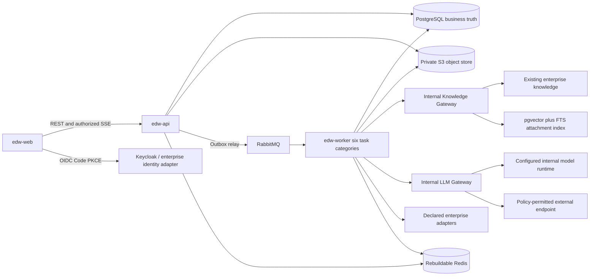
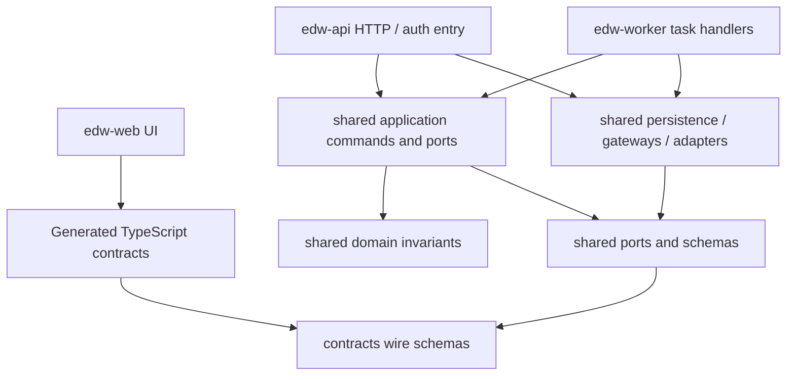
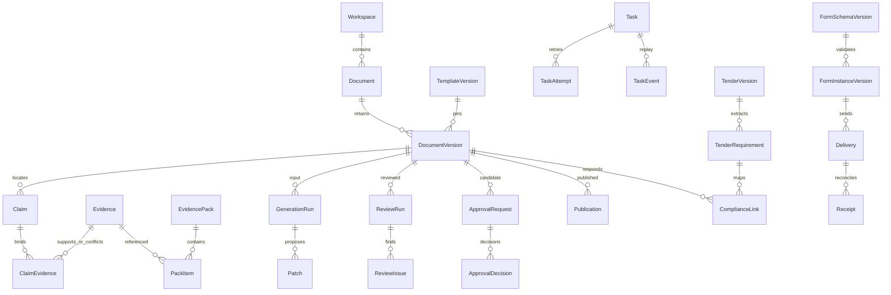

## 当前开发与验证边界（2026-09-21）

执行软件层面的开发、代码检查和编译验证；不启动实际运行环境进行功能实测，也不使用已启动的实际环境进行功能实测；不进行实物、硬件或现场运行验证。

本文件的执行安排统一受[开发与验证规则](development-validation-policy.md)约束。下文涉及启动、部署、迁移、fixture、功能测试、浏览器实测、联调、性能和故障演练的条款保留为待执行验收要求，当前暂停执行并记录 `not-run`；其中静态检查与编译可按规则单独执行。历史证据按原日期保留，不代表本轮通过或继续运行的授权。


# 企业智能文档编写工作台架构契约

## 0. 状态、依据与使用边界

这是 **S3 作者草稿，不是 S3 独立门禁通过记录**。主控已确认上游 PRD/S1、UX/S2 通过；其历史 pending/worktree 文字不构成本阶段新阻塞。本次只编制架构，不生成 Epics/Story、不编码、不执行数据库、部署、模型调用或产品测试，不提交、不外部发布。

输入优先关系：已确认访谈/AGENTS 的工程与授权边界 → 已批准 PRD 与 UX → docs/07 技术基线 → docs/01–06 详细规范。原型保留原始视觉；UX 显式列出的真实业务替换与补充为获准差异。旧材料的独立 Gateway/多 Worker 服务图不得扩展为第四工程。本文新增的是跨工程实现契约，不新增业务授权、厂商能力或企业政策。

主项目 `D:/Desktop/eid` 仅作为只读输入。本草稿位于当前获准 worktree，由主控另行处理主目录落盘与独立审查。本文所有目录、接口扩展、命令和部署描述都是 **待实现 seed**；除明确列出的文档/官方资料读取外，没有执行成功证据。实际像素、字体、AA、模型效果、企业联调、生产容量/恢复/SLA 均未验收。

## 1. Design Paradigm

**模块化单体 + 六边形架构 + 持久化状态机驱动异步流水线。** Document Engine 维护领域事实；模板、Evidence、规则与人工决策约束生成。LLM 是产生候选结果的外部能力，不是权限主体或自治控制器。

- `edw-web` 是唯一浏览器工程，REST/SSE/OIDC 接入，不接业务库、消息队列、模型或企业内部接口。
- `edw-api` 是唯一业务入口与模块化业务单体：权限、文档/AST/版本、模板、Evidence/Claim、任务编排、审批发布、投标、表单、审计和管理。
- `edw-worker` 是唯一后台工程：generation、retrieval、review、parse_ocr、render、integration 六类工作，同源代码可运行多个队列进程和隔离镜像。
- `shared/python` 内的领域/application/persistence、Knowledge Gateway、LLM Gateway 为仓库内复用代码，不是可单独运营的第四工程；只提供库入口，无监听端口、独立产品版本或独立部署服务。
- 基础设施、模型运行时及企业系统不是业务工程；`contracts`、`migrations`、`deployment`、`tests`、`evaluation` 是交付目录。



代码依赖方向也是约束，不允许以共享目录绕过边界。



领域层不得 import FastAPI/Celery/Tiptap/具体模型 SDK；API 不 import Worker handler，Worker 不 import API router；两者不复制 ORM/AST/权限/状态转换规则。组合根注入适配器，模块间通过显式命令/查询/事件，不跨模块私有 repository 写表。

## 2. Invariants & Rules

### AD-1 — 三工程与单一领域所有权 [ADOPTED]
- **Binds:** 全部工程，FR-48，C-1–C-8。
- **Prevents:** Gateway 微服务膨胀、重复领域模型和 Worker 任意写业务表。
- **Rule:** 上述三个工程为唯一工程边界。领域 owner 维护共享命令与数据库映射；API 执行用户业务命令，Worker 仅执行其类型允许的任务状态/产物/分析结果命令。人工编辑、Patch 接受、审批、发布、权限修改只能由 API 的当前用户授权入口调用。数据库角色按 API/Worker/迁移分离；Worker 不具备审批决策、发布记录、权限策略表写权限。共享库不是 Worker 授权的替代品。

### AD-2 — AST 与版本独立于编辑器 [ADOPTED]
- **Binds:** FR-5/6/9–11/21/39–41，C-2/C-8。
- **Prevents:** Tiptap JSON 成为公共领域协议、AI 覆写人工内容、旧版本随规则更新漂移。
- **Rule:** PostgreSQL 中不可变 DocumentVersion 的 domain AST 是正文真相；Tiptap/ProseMirror 只通过双向 Adapter。保存与接受 Patch 均核对 `base_version_id + document_revision`，成功创建新版本并原子移动 Document head。内容版本与模板/模型/Prompt/规则/渲染主题/schema 版本显式绑定。未知 AST 节点只读保留，不默默丢弃或 HTML 扁平化。已 Published 版本只读，修订创建新候选并重新走门禁。

### AD-3 — 短事务、受保护提交与事务 Outbox [ADOPTED]
- **Binds:** C-2/C-3/C-7/C-8，FR-21/27–31/43–46。
- **Prevents:** DB/MQ 双写丢任务、长模型调用锁库、旧权限下迟到的结果提交。
- **Rule:** 同一业务事务提交状态变化、审计必需记录、Task/Event/Outbox；发布消息发生在提交后。LLM/RAG/OCR/渲染/HTTP 外部调用不得持有数据库事务或行锁。执行前读出固定输入，在外部工作结束后短事务核对版本、policy epoch、任务 lease/fence/cancel 与结果散列；不符合则保存受限候选/失败原因，不施加副作用。每请求/线程/并发任务有独立 Session，API/Worker 独立连接池，fork 后重新建池。

### AD-4 — 至少一次传输，不承诺外部恰好一次
- **Binds:** FR-19/44/45，C-3/C-8。
- **Prevents:** 重投重复版本、收到消息就标完成、重试双调外部系统。
- **Rule:** PostgreSQL Task/Attempt/DAG 为权威；RabbitMQ/Celery 为传输。Outbox 发布确认后标记，崩溃重投安全。Inbox 唯一键 `(consumer,event_id)` 结合执行 lease 与终态处理；received 不等于 processed。任务完成事务将结果索引、状态、后继 Outbox、SSE event 与 Inbox processed 原子提交。外部效果用独立 EffectIntent/Receipt，超时进入待核对；不能凭 Celery ACK 或幂等键宣称远端恰好一次。

### AD-5 — 可重放、带当前鉴权的 SSE
- **Binds:** FR-19/44/45，P-04/X-16，C-1/C-3。
- **Prevents:** SSE 丢失等于任务丢失、URL token 泄漏、重连重复应用事件。
- **Rule:** `/tasks/{id}/events` 读取持久化 TaskEvent，单任务递增序号，支持 `Last-Event-ID`。Web 以 fetch streaming 带 Bearer header 解析标准 SSE，不把 token 放查询串，不假定原生 EventSource 支持任意 header。定期当前授权核对，撤权/过期断流；REST snapshot 可重建缺口。SSE 只传安全摘要/ID，正文、Evidence 原文、完整模型输出均通过重新鉴权的 REST 取。

### AD-6 — 分类执行与危险工具隔离 [ADOPTED]
- **Binds:** 六任务类型，FR-17/22/30/44，NFR-7。
- **Prevents:** OCR/LibreOffice/Mermaid 逃逸访问业务凭据、渲染资源耗尽拖垮生成。
- **Rule:** 六类队列有各自并发/限流/超时/重试配置。parse_ocr 与 render 使用独立 Worker 进程/镜像；危险二进制在无 DB/MQ 凭据的子隔离容器执行，挂载单任务输入和输出目录，非 root、只读 rootfs、网络禁用、seccomp、CPU/内存/PID/临时盘限额、超时终止和清理。受信 Worker supervisor 负责下载与结果验收。模型只能请求白名单操作，不能生成 shell、Python、路径或工具参数执行权限。

### AD-7 — 当前权限而非历史快照 [ADOPTED]
- **Binds:** C-1/C-4/C-6，FR-4/12–17/27–31，NFR-1–6。
- **Prevents:** 旧 JWT/缓存/引用/签名下载继续泄露撤权资料。
- **Rule:** 每次获取和使用满足 RBAC 操作 AND ABAC 范围 AND 密级；权限快照仅溯源。检索前后、模型上下文前、引用查看与插入、Patch 接受、审批发布、导出/下载/回流/企业投递均重验。项目、用户、资源策略有持久化 epoch 与失效事件；缓存按主体/范围/epoch 分区。收到撤权清除 Web Query、编辑器中无权源摘录、任务订阅及服务器缓存；不能证明当前外部 ACL 则拒绝相关获取/使用。服务身份不能扩大原发起人的权限。

### AD-8 — 双知识链与可定位 Evidence [ADOPTED]
- **Binds:** FR-12–18/31/34，C-4。
- **Prevents:** 强迫重建企业知识库、附件伪装正式知识、相似度掩盖冲突。
- **Rule:** 既有 KB 经能力声明适配，不假设厂商检索或 ACL API；附件链使用授权文件的 pgvector+FTS。Evidence Builder 统一当前 ACL、精确匹配、去重、权威/有效版本/适用范围排序和冲突标记。知识权威 L0–L8 与安全密级 L0–L3 分开。生成只拿固定 Evidence Pack，不直连索引。来源/版本/页或章节/chunk/规则/授权快照散列可追溯，缺失支持为 pending/unknown，不能制造引用。

### AD-9 — 模型政策强制链 [ADOPTED]
- **Binds:** FR-18–23，C-5，NFR-3/4。
- **Prevents:** 外部模型降级绕过密级、检索内容注入控制器、无来源数字进入正文。
- **Rule:** `Classify → DLP → Policy → Redact → Model Router` 唯一调用路径；L3 永不外发，L2 默认内部且未配置明确例外拒绝外发，L0/L1 亦按策略、L1 脱敏。拒绝不能自动换更宽松 provider。Prompt/模板/模型配置版本化，上下文含事实、术语、约束、章节依赖、Evidence 与 token 预算。输出按 schema 校验，仅一次结构修复；仍失败进入真实失败状态。检索/招标/附件内容为不可信数据，不接受其权限或工具指令。AI 写操作仅产 Patch/发现，摘要/查询不改 AST。

### AD-10 — 八 Reviewer 与版本固定人工审批 [ADOPTED]
- **Binds:** FR-23–29/33/34，C-7。
- **Prevents:** 分数当批准、Reject/Handled 自动清除严重问题、旧 Review 认证新正文。
- **Rule:** structure/fact/requirement/technical/quality/consistency/style/security 八个 Reviewer 各自记录 run、input version、规则/模型/Prompt、成功/失败与定位结果；缺失任何必需项即不完整。Issue accepted=修复已应用待复核，rejected=有理由的拒绝，不代表问题已消失；fixed/closed 必须复核。waived 必须已配置授权人与理由且不能豁免不可豁免项。审批绑定候选内容散列与规则/策略/模板版本，候选改变则失效，Reviewer 不能自批其严重问题。

### AD-11 — 发布与可信回流分为两个门 [ADOPTED]
- **Binds:** FR-27–31/38/43，C-7/C-8。
- **Prevents:** Gate preview 被当发布许可、草稿污染 Golden、回流失败回滚已发布事实。
- **Rule:** API 发布提交时在当前版本/策略下重新计算全部门禁并与审批、审计原子提交；不得信任先前 UI 的绿灯。Published 事件触发独立 Knowledge Quality Gate，合格才进入解析/元数据/回流并核对远端 receipt。回流失败不撤销发布，重试不生成重复可信条目。正式使用、试导出与开发样例必须显式区分。

### AD-12 — 对象存储隔离与受控获取 [ADOPTED]
- **Binds:** FR-17/30/41，C-6，NFR-6/7。
- **Prevents:** 上传即可公开、恶意文件即执行、旧签名 URL 跨撤权继续下载。
- **Rule:** 上传隔离区、已验证原件、解析中间物、正式/开发输出分别设私有前缀和受限身份。API 分配对象 key，客户端不能指定任意 bucket/path。MIME/魔数/扩展名/大小/压缩膨胀/加密文件政策/恶意内容校验完成才调度解析。下载只经当前鉴权 API 或鉴权后 NGINX internal 位置，默认不暴露可长期重用 S3 GET URL；断点范围请求同样重验。过期/失败/部分结果不是可下载成功产物。

### AD-13 — 二期文种与投标不降为占位 [ADOPTED]
- **Binds:** FR-9–11/32–38，C-2/C-4/C-7。
- **Prevents:** 只交付技术方案、招标解析完成被当合规完成。
- **Rule:** 五种二期文档沿同一模板/上下文/生成/审校/审批发布流水线加类型规则。投标有版本化 tender requirement、人工纠正、bidirectional compliance link、废标/强制/评分规则定位；来源或响应变更标记关联 stale 并重验，缺漏/冲突/未确认强制项进入共同正式发布阻断，不以综合分抵消。

### AD-14 — 独立表单 Schema 与单一规范化值 [ADOPTED]
- **Binds:** FR-39–41，C-8。
- **Prevents:** 以富文本冒充表单、前后端验证不一致、打印/OCR 结果覆盖原值。
- **Rule:** FormSchemaVersion 独立于 Document AST，实例固定 schema 和自身 revision。11 种字段由白名单 registry 映射；Python 服务器验证为真，前端执行同一 JSON Schema 支持子集及共享测试向量。公式只准显式语法/函数，类型/依赖/环检测与预算，不用 eval。Web/DOCX/PDF/XLSX/print 使用同一 Canonical Form Snapshot；扫描/OCR 仅提出待人工确认值。签名字段不宣称合规电子签章，条码不携带授权。

### AD-15 — 企业效果意图、收据与待核对 [ADOPTED]
- **Binds:** FR-31/42/43/45，C-8。
- **Prevents:** 超时盲目重试重复投产、模拟适配器被当真实厂商联调。
- **Rule:** 每适配器声明鉴权、版本、映射、幂等、查询收据、回调认证、限流、重试与补偿能力；缺能力不得臆造。EffectIntent 固定目标/业务对象版本/散列/去重键，尝试与 receipt 单独保存。未知结果先查询原 correlation，不能查且无可靠远端幂等时暂停人工核对，不自动再投。Webhook 验签和防重放后 Inbox 去重；部分投递按目标独立核对。真实企业环境必须独立验收。

### AD-16 — 原型基线不可重设计 [ADOPTED]
- **Binds:** P-00–P-12/SUP-1–SUP-9/X-01–X-20，NFR-16/17。
- **Prevents:** Ant Design 默认样式代替原型、补页冒称像素还原、toast 冒充真实结果。
- **Rule:** 原始 `docs/prototype/index.html` 不改。已存在页按原型+DESIGN 精确 tokens/几何/字体继承/图形还原；仅 EXPERIENCE 的 B/R/S 登记允许示例变真实和补充。没有授权的移动堆叠、侧栏收起、新 topnav、暗色主题不加入。所有状态使用持久化真实对象/任务，未配置/未测不是零分或成功。VC-1/VC-2 显式保留，不能同时虚称 AA 与 1:1 已过。

### AD-17 — 兼容升级与独立恢复证据 [ADOPTED]
- **Binds:** FR-45/48，NFR-12–15/18。
- **Prevents:** API/Worker 滚动升级读不懂消息、迁移锁长表、备份存在即声称恢复。
- **Rule:** 单一 Alembic 迁移链，expand→兼容部署→可重入回填→验证→以后 release contract。当前及相邻部署版本兼容事件/AST schema；未知主版本隔离，不静默处理。迁移为独立受限 job，不由每个 API/Worker 启动。生产 PostgreSQL HA/WAL/PITR、对象版本/备份、身份与密钥配置均纳入恢复；恢复后核对业务/对象/任务/外部 receipt，演练验证 RPO/RTO，不以 Compose 启动替代。

### AD-18 — 三验收账本、策略不能由 Flag 绕过 [ADOPTED]
- **Binds:** FR-33/34/47/48，全部 NFR。
- **Prevents:** deterministic mock 证明 AI 效果、开 Flag 绕过门禁、未测容量变承诺。
- **Rule:** 本地真实三工程契约、真实模型/企业接口、生产 NFR 分账记录，状态含未运行/通过/失败/阻塞及环境 manifest。Flag 是可用性开关，最终许可始终 `flag_enabled AND current_authorization AND mandatory_gates`；默认安全、版本化/审计，不得替代审批或部署授权。中质量检查→优化→验证与独立审查不被作者自检替代。

## 3. Stack 与版本核验边界

下表为 **docs/07 已采纳技术集合，而非安装完成的 lock manifest**。不选择新 starter 替换它。Python 3.12、Pydantic 2、SQLAlchemy 2、psycopg 3 为源约束；其余精确 patch、Node LTS、镜像 digest 与互操作组合须工程启动时以官方发布/安全信息验证后锁定，不能写 `latest` 进交付配置。本稿不伪造全栈“最新版本已核验”。

| 范围 | 采纳技术 / 版本约束 | 冷启动交付约束 |
|---|---|---|
| edw-web | TypeScript、React、Vite SPA；Ant Design、React Router、TanStack Query、Zustand | pnpm workspace；Node 受支持 LTS 待验证锁定；pnpm-lock.yaml 固定包解析 |
| 编辑器 | Tiptap 开源核心 / ProseMirror；自定义 domain adapter | 不依赖云协作或付费插件；AST round-trip 测试先于复杂编辑 |
| edw-api | Python 3.12、FastAPI、Uvicorn、Pydantic 2 | REST/OpenAPI、schema 校验、短事务 application commands |
| API/Worker 持久化 | SQLAlchemy 2、psycopg 3、Alembic；PostgreSQL + JSONB | 同一映射/迁移 owner，进程独立池；pgvector、FTS 和 jieba 企业词典 |
| edw-worker | Python 3.12、Celery、RabbitMQ quorum；single-active Beat | 使用 `task_default_queue_type` 时 Celery 至少 5.5；官方页面当次显示 5.6.3，并非已选 lock；显式声明六队列与 publisher confirm |
| 状态与对象 | Redis；S3 API 默认 SeaweedFS | Redis 可重建；SeaweedFS S3 行为、加密/版本/备份配置待契约验证，不臆造默认能力 |
| 知识/模型 | BGE-M3、bge-reranker-v2-m3 / FlagEmbedding；httpx+Pydantic LLM Gateway；vLLM | 模型权重修订/许可/资源待锁定；Qwen3-32B 仅 Planner/Writer 评测候选，非容量或效果承诺 |
| 解析/渲染 | pypdf、python-docx、openpyxl、PaddleOCR；python-docx/docxtpl、LibreOffice、Mermaid CLI | 镜像含明确字库/theme manifest；危险工具隔离；PlantUML 未配置时只给安全源码提案，不引入隐形执行器 |
| 表单 | versioned JSON Schema，React 字段组件，Python JSON Schema 校验器 | wire dialect 采用 2020-12 的批准子集；禁远端 `$ref`，以本地版本 registry 解析；公式另有 schema/白名单 |
| 身份/边缘 | Keycloak OIDC、NGINX TLS/static/proxy | Code+PKCE S256；公开 SPA client；服务凭据仅服务器；SSE 不缓冲 |
| 运维 | Docker/Compose；Kubernetes/Helm；CloudNativePG+Barman Cloud | 等效已批准企业 PostgreSQL 可适配；生产 HA、故障域、备份恢复待环境验收 |
| 观测/质量 | OTel Collector、Prometheus、Grafana、Loki、Tempo、Alertmanager；pytest、Vitest/RTL、Playwright、k6；Ruff/mypy、ESLint/tsc | 锁 uv.lock/pnpm-lock、schema/model/theme版本与测试 manifest；未执行 |

2026-09-08 的有限官方机制核对：

1. [Celery quorum 配置](https://docs.celeryq.dev/en/stable/userguide/configuration.html#task-default-queue-type)：quorum 要 publisher confirm，支持项自 5.5 增加；据此显式声明而不沿用默认 classic。
2. [Tiptap persistence](https://tiptap.dev/docs/editor/core-concepts/persistence)：支持 JSON/HTML 持久化；本项目进一步用 domain Adapter，不采用其 localStorage 示例存敏感正文。
3. [MDN EventSource constructor](https://developer.mozilla.org/en-US/docs/Web/API/EventSource/EventSource)：构造项为 URL/withCredentials，故本项目用 fetch SSE 保持 Bearer header。
4. [Keycloak JavaScript adapter](https://www.keycloak.org/securing-apps/javascript-adapter)：public client、精确 redirect/origin、内存 token、路由前初始化与 refresh；不假设浏览器第三方 cookie/静默 SSO 永远可用。
5. SQLAlchemy 官方 Session 页定向 section 抓取未命中，未作为机制核验成功证据。每请求/并发单元独立 Session 仍为本架构明确约束，后续具体 API 使用需官方文档/测试核实。

这些核对不是完整的依赖安全审计、兼容矩阵或安装测试；精确版本核验/许可证/SBOM 是启动实施门禁，不重开用户已确认技术选型。

## 4. Structural Seed 与数据所有权

### 4.1 最小仓库结构

```text
eid/
  edw-web/
    package.json
    src/
      app/                 # router, OIDC bootstrap, providers, shell
      features/            # workspace, documents, editor, templates, knowledge,
                           # reviews, approvals, tender, forms, integrations, admin
      components/          # DESIGN 对应通用组件
      editor/              # domain AST adapter, extensions, selection bookmark
      api/                 # generated client facade, query keys, fetch SSE
      styles/              # prototype tokens, scoped overrides, UA fidelity fixes
      assets/              # approved local resources + font/license manifest
    tests/
  edw-api/
    pyproject.toml
    src/edw_api/
      main.py
      http/v1/             # route/schema/auth boundary only
      bootstrap/           # composition root and dependency wiring
    tests/
  edw-worker/
    pyproject.toml
    src/edw_worker/
      app.py
      handlers/            # generation,retrieval,review,parse_ocr,render,integration
      orchestration/       # relay, dispatcher, lease recovery, Beat jobs
      runners/             # isolated tools input/output protocol
    images/                # same project: normal, parse-ocr, render tool images
    tests/
  shared/python/edw_shared/
    domain/                # document/template/evidence/review/tender/form/task rules
    application/           # public module commands, UoW, gate calculation
    ports/                 # knowledge, model, identity, storage, enterprise contracts
    persistence/           # single SQLAlchemy metadata and repositories
    gateways/              # internal knowledge + llm modules
    security/              # current policy/DLP/audit enforcement
    adapters/              # declared infra and enterprise implementations
  contracts/               # OpenAPI, JSON Schema, task envelopes, test vectors
  migrations/              # alembic.ini, env, single versions chain
  deployment/              # compose.local.yaml, NGINX, Helm, policies, backups
  tests/                    # cross-project contract, E2E, security, fault, perf
  evaluation/              # versioned queries/defects/manifests, local vs real runs
  scripts/                 # environment guard, contracts, build/evidence automation
  pyproject.toml            # Python workspace and shared package configuration
  uv.lock
  pnpm-workspace.yaml
  pnpm-lock.yaml
```

树是待实现结构，不声称这些应用文件已经存在。`shared/python` 可构建被 API/Worker 引用的私有库包，但不是额外业务工程；同 commit 生成共享 wheel、API/Worker 镜像与契约，避免拷贝两份源。

### 4.2 模块表与提交权

| 领域 owner | 主数据/索引 | API 用户入口 | Worker 允许结果写 |
|---|---|---|---|
| Workspace/Identity/Policy | Workspace、Project scope、Membership、PolicyVersion、PolicyEpoch | 认证、角色/范围变更、项目/收藏/引用/逻辑回收、管理 | 接收已认证同步的受限投影；不得授权自己 |
| Document Engine | Document head/revision、DocumentVersion AST、Section/Block、Patch、PendingItem、context/outline | 创建/编辑/合并/接受拒绝 Patch、人工确认 | GenerationRun、候选 Patch、分析结果；不得移动正文 head |
| Template | Template、TemplateVersion、rule/theme refs | 上传、验证请求、publish/deprecate | 验证/预览结果，不发布模板 |
| Knowledge | SourceVersion/Chunk locator、Evidence、Claim、ClaimEvidence、EvidencePack | 授权读取/引用、治理确认 | 授权解析/检索/验证结果和索引；不得扩大源权限 |
| Review/Approval/Release | ReviewRun/Issue、ApprovalRequest/Decision、GateEvaluation、Publication、ReturnRecord | Issue disposition、审批决策、原子发布 | Reviewer findings/复核结果、回流任务和 receipt；不得写人工审批/发布表 |
| Task orchestration | Task/Step/Attempt、TaskEvent、Outbox/Inbox、EffectIntent | 创建/取消/允许重试/查询 | 受类型与 fence 保护的进度/结果/后继调度 |
| Tender | TenderVersion、ExtractionVersion、Requirement、Correction、ComplianceLink | 上传确认、纠正/映射 | 页级解析、提案/检测结果；不能确认招标条款 |
| Forms/Integration | FormSchemaVersion、FormInstance/Version、CanonicalSnapshot、Delivery/Receipt | schema 激活、实例保存、投递请求/核对 | scan proposal、render、已声明外部 delivery receipt |
| Audit/Quality | AuditEvent、MetricDefinition、EvaluationRun/Case | 受权查询/配置版本 | append-only 安全事件/运行指标；不能改历史审计 |

跨模块事务由 application 用例统一 UoW 调用公开服务，不由 router 拼散落 SQL。普通 Worker DB 角色仅在白名单表/命令中写；敏感发布/审批表通过 DB grants 与 API 专属事务路径隔离，迁移身份不下发运行时。共享校验没有独立服务绕行。

### 4.3 核心实体关系与索引



数据库约束至少包含：`(document_id,revision)` 唯一；Document head 必须指向本 Document 版本；模板正式引用禁止硬删；`(task_id,seq)`、`(consumer,event_id)`、`(aggregate_id,event_id)`、`(scope,operation,idempotency_key)` 唯一；Publication 的文档/版本/发布意图唯一；Receipt 外部业务键按 connector contract 唯一。外键保存对象 locator 引用而非允许直接公开 key。

热点索引：workspace+authorized scope+updated_at 游标列表；document/version/section 查 AST；task owner/status/category/next_retry_at、lease_until；Outbox pending/next_retry_at；ReviewIssue run/severity/status；Claim document_version/block；Evidence source_version/chunk/policy；FTS GIN、pgvector 适配索引与元数据过滤；audit time/actor/resource/trace。索引/向量参数以授权检索与实际数据执行计划验证，不默认 ANN 过滤后还会满足 top-k。

## 5. Consistency Conventions 与跨工程契约

### 5.1 通用格式

- API 前缀 `/api/v1`；JSON UTF-8；标识符为不可猜测 opaque string，内部 UUID，前端不得解析业务含义；UTC RFC3339 时间；界面按用户时区显示；金额/精确小数用十进制字符串加单位，不能 JS 浮点悄改验收值。
- JSON 属性 `snake_case`；TS UI 可内部 camelCase，但生成 client 边界统一转换。列表 cursor pagination，所有筛选 AND 合并；不可授权计数也不得泄漏。
- 请求携带 `Authorization: Bearer`、`X-Request-ID`（服务端校验/生成）、`traceparent`、写入 `Idempotency-Key`。actor/tenant/workspace/security labels 由服务端认证和资源推导，客户端值不是权限声明。`tenant_id` 是源契约兼容字段，不引入新 SaaS 多租户工程。
- 写入幂等记录绑定 actor/授权 scope、操作+目标、请求规范化散列和返回资源；相同键不同内容 `409 IDEMPOTENCY_KEY_REUSED`。重试前仍检查当前授权；不得把原成功正文返回已撤权者。安全保留周期由策略定义，不能过期后对发布/外部投递遗忘永久业务唯一键。
- 正常创建 `201`；异步 `202 {task_id,state,status_url,events_url}`；命令同步成功返回新对象/revision；no-op 去重返回同一资源标识。统一错误 `{error:{code,message,details,request_id,trace_id,retryable}}`，details 不含秘密或不可见资源。
- 401 token 缺失/失效；403 已可见对象上动作不允许；404 用于防资源存在性泄漏；409 版本/状态冲突；422 schema/可纠正门禁输入；429 限流带 Retry-After；503 必需依赖/审计不可用。不将业务失败包装 HTTP200 成功 toast。

| 来源错误 | 本架构 HTTP seed | 恢复 |
|---|---|---|
| DOC_VERSION_CONFLICT | 409 | X-02 保留 base/local/latest，比对后显式合并 |
| TEMPLATE_DEPRECATED | 409 | 换允许模板或已声明政策，不重写历史 |
| KNOWLEDGE_PERMISSION_DENIED | 403，隐藏存在性时404 | 清除摘录，选择当前允许源 |
| EVIDENCE_REQUIRED / MISSING_CONFIRMATION | 422 | pending/人工确认，不编造 |
| EVIDENCE_STALE | 409 | 更新源后重验 Claim/Review |
| MODEL_NOT_ALLOWED | 403 | 只可选择已配置允许路线，无宽松 fallback |
| REVIEW_GATE_FAILED | 422 | 返回当前可见 blocker IDs；安全依赖故障503 |
| EXPORT_FAILED | task terminal FAILED；同步依赖503 | 原固定版本安全重试，不能下载残件 |

### 5.2 C-1–C-8 绑定表

`contracts/` 的 schema 是 wire 真相；API Pydantic 导出 OpenAPI 与 JSON Schema，经 CI 漂移检查生成 TS，Python 消费者使用同一模型/校验向量。独立开发不得手写第二套字段语义。下列为最小必备字段，业务字段以来源 S03/PRD 补齐；所有新增枚举需版本兼容。

| 契约 | 必需载荷与版本 | 生产者 → 消费者 / 不变量 |
|---|---|---|
| C-1 身份/请求/任务上下文 | request_id、trace_id、actor_id、service_id、tenant_id、workspace_id、policy_epoch、classification、purpose；delegation_scope | API 校验生成→共享授权/Worker；不序列化用户 token 到消息，任务执行时重新解析当前主体/ACL |
| C-2 文档/版本/Patch | schema_version、document_id、version_id、document_revision、base_version_id、template_version_id、content_hash、AST；Patch typed operations + target stable IDs + generation_run_id | API→Web，Worker→受限提案；accept 是 API 当前授权短事务并返回新版本；不是客户端直接 PATCH JSON path |
| C-3 任务/事件 | message_schema_version、event_id/type、occurred_at、aggregate_id/version、task_id、category、input_ref/hash、actor/scope refs、trace；Task state/stage/progress/attempt/result_ref/error | Outbox→MQ→Inbox/Worker→TaskEvent→SSE；幂等、fence、快照恢复、乱序检查 |
| C-4 知识/Evidence/Claim | source_document_id/source_version/source_section/chunk_id、page/bbox locator、authority、effective_at、classification、permission_policy_id/snapshot_hash；Claim type/subject/predicate/value/unit/condition/criticality/status；relation supports/conflicts/contextual | 两检索链→EvidenceBuilder→生成/Review/当前授权 Web；Pack pins source refs/hash/policy/retrieval/rerank versions，snapshot 不授权 |
| C-5 模型/Prompt | operation、prompt_template_id/version、model_profile/version、policy/DLP/redaction version、input/output hash、EvidencePack ID、token budget/usage、timeout/repair_count、route denial | Orchestrator→内部 LLM Gateway→配置 provider；response schema 校验、原始敏感 Prompt 非普通日志 |
| C-6 文件/渲染/下载 | upload_id、object_ref、hash、size/MIME、classification、validation state；export_id/task_id/version_id/format/render_theme_version/font_manifest、artifact hash/status/expiry | API→隔离 Worker→API；API 决定 key 与当前读取，不把对象地址当授权 |
| C-7 审校/质量/发布 | ReviewRun pins version/rules/model/template；Issue location/severity/status/resolution+recheck；Approval candidate hash/policy/decisions；Gate blocker codes/definition versions/evaluated_at | Worker 分析→API disposition/approval/publication；门禁预览无授权效力，提交重算 |
| C-8 表单/集成 | schema_id/version/dialect/hash、instance_id/revision、canonical_snapshot/hash、delivery_id、connector/contract_version、mapping_version、effect_key、correlation、attempt/receipt/status | API→Worker→已声明 adapter/Inbox；schema 和实例独立，未知远端结果不得重发假定成功 |

所有版本化消息支持当前 N 和相邻仍运行 N-1；添加字段兼容、删除/改变语义要新主版本+双读/迁移。未知 enum/schema 保留/隔离并报告，不默认为 success。消息只传定位/散列/最小上下文，不传整份正文/Evidence 或密钥。

### 5.3 REST seed 与 UI 路由的连接

来源规定的接口不改语义：

- documents create、`/{id}/plan`、`/{id}/sections/{section_id}/generations`、`/{id}/patches`、`/{id}/patches/{patch_id}:accept|:reject`、`/{id}/reviews`、`/{id}/review-issues`、`/{id}/exports`。
- knowledge/search、knowledge/evidence-packs、knowledge/similar-documents、knowledge/documents/{id}、knowledge/chunks/{id}。
- templates list/create/detail、`/{id}/versions`、`/{id}:publish|:deprecate`；review-issues/{id}:resolve；tasks/{id}/events。

补齐跨工程一致性所需的新接口 seed（待实现，非现有服务宣称）：

| API family | 操作与必要 guard |
|---|---|
| `/me`、`/workspaces`、`/projects`、`/search`、`/favorites`、`/references`、`/recycle`、`/notifications` | 当前授权列表/计数、项目切换、收藏、内部引用、逻辑回收/允许恢复；不提供公开分享/物理删除 |
| `/documents/{id}/versions`、`/versions/{version_id}`、`/documents/{id}/context`、`/outline:confirm` | 保存新版本含 base/revision；context/outline固定版本确认；history只读；merge仍走新版本保存 |
| `/documents/{id}/copilot`、`/pending-items/{id}:resolve` | operation 白名单、稳定 selection target；只读操作不创建正文修改；写操作返回 task/Patch |
| `/tasks`、`/tasks/{id}`、`/tasks/{id}:cancel` / `:retry` / `:reconcile` | 类别/主体/项目过滤；cancel request→authoritative state；unknown outcome不直接retry |
| `/uploads`、`/uploads/{id}:complete`、`/artifacts/{id}/content` | 隔离上传票据、文件验证任务、当前授权流式下载/Range；不返回公开 bucket |
| `/documents/{id}/approvals`、`/approvals/{id}:approve` / `:reject`、`/documents/{id}/release-gate`、`/documents/{id}:publish` | pinned candidate+policy；gate GET仅预览；publish确认/revision/idempotency/current gates |
| `/knowledge/return-records`、`/knowledge/return-records/{id}:retry` / `:reconcile` | 仅已有 Published eligible input；API不开放草稿强制回流 |
| `/tenders`、`/tenders/{id}/versions`、`/requirements`、`/requirements/{id}/corrections`、`/compliance-links` | tender source locator、确认状态、版本失效；matrix双向查询与共同Review |
| `/form-schemas`、`/{id}/versions`、`/{id}:activate`、`/form-instances`、`/{id}/versions`、`/{id}/scans` | schema校验/明确激活、实例乐观锁、扫描只提案；不执行任意类型代码 |
| `/deliveries`、`/deliveries/{id}`、`/{id}:reconcile` / `:retry`、`/integrations/{connector_id}/inbox` | fixed snapshot/contract；用户请求与服务回调身份隔离；验签/去重/原correlation |
| `/quality/definitions`、`/evaluation-runs`、`/admin/{area}`（policies / models / prompts / connectors / flags）、`/audit-events` | 细粒度授权、版本/理由/审计；未配置为不可用，不返回伪造指标 |

## 6. Domain AST、并发与持久化状态机

### 6.1 AST 与 Tiptap Adapter

领域 wire 保持 S03 顶层：

```json
{"schema_version":"1.0","document":{"metadata":{},"sections":[],"claims":[],"citations":[],"review_state":{}}}
```

允许 block kinds 精确为 `paragraph, heading, table, figure, diagram, requirement, citation, warning, code, form`。列表用受控 paragraph/list metadata、图像由 figure、安全 diagram 保存源码/渲染引用；测试用例保留经 schema 批准的 requirement/table 结构，不自行另造不兼容 wire type。Section/Block/Claim/Citation 为稳定 ID；heading 层级、必需章节与模板结构一起校验。requirement 保留 requirement_id/statement/verification_method/source_refs，业务 PRD/test 字段不因富文本格式丢失。

Adapter 的 `domainToEditor`/`editorToDomain` 是唯一双向入口，保留 metadata、unknown extensions、表格单元格/跨行、图片比例/alt、引用/Claim位置、requirements/form refs；未支持节点展示只读+错误，整稿保存不能吞掉它。导出/Reviewer/生成读取 domain AST，不抓浏览器 DOM 或 Tiptap 私有 JSON。

编辑 Session 记录 server base、dirty buffer、undo栈、selection bookmark（document/version/section/block+范围），typing idle1000ms debounce 提交，与服务端 autosave P95 分开。后台保存只允许本次请求对应 draft revision 更新“已保存”，不覆盖其后输入。Ctrl/Cmd+S立即请求；跳转先 Save/Stay/明确丢弃内存。无授权不做 IndexedDB/localStorage 敏感离线存储。

并发：两用户基于同 version/revision 保存，短事务 `UPDATE Document ... WHERE revision = expected` 只允许一个成功；另一个409保留本地草稿，X-02三路 merge。Patch operation 使用 stable block IDs、预期内容散列和可接受操作集合，禁止任意 JSON pointer 越权写 metadata/ACL；accept 重新校验可见源、模板、base与policy，创建新 immutable version。拒绝 Patch 不改变正文。插引用必须验证当前 bookmark与源权，不再插入“第一个段落”。

### 6.2 状态分层与转换

这些是不同持久化对象，不能复用一个 status 字段互相推导。

| 层 | 正常与异常状态 | 转换 owner / guard |
|---|---|---|
| Document lifecycle | DRAFT→CONTEXT_READY→OUTLINE_READY→GENERATING→REVIEWING→USER_REVIEW→APPROVAL_PENDING→PUBLISHED→ARCHIVED；GENERATION_FAILED/REVIEW_FAILED/EXPORT_FAILED/BLOCKED_BY_MISSING_INFO | application显式业务命令；上下文/大纲有人工确认；任务失败关联 operation不丢正文；Published导出失败只在export outcome表示，不把Published逆转 |
| OrchestrationRun | CREATED→PREPARING_CONTEXT→CONTEXT_READY→PLANNING→OUTLINE_READY→GENERATING→REVIEWING→USER_REVIEW→COMPLETED | DAG依赖持久化；outline确认后才生成；COMPLETED指编排结束，不是Published |
| SectionTask stage | PENDING→RETRIEVING→EVIDENCE_READY→GENERATING→VALIDATING→DONE；RETRY_WAIT/FAILED/BLOCKED/CANCELLED | 每步输入/输出 ref、attempt、checkpoint、lease/fence；缺证据/待确认BLOCKED，不重试编造 |
| 通用 Task status | QUEUED/RUNNING/RETRY_WAIT/BLOCKED/SUCCEEDED/FAILED/CANCELLED/DEAD_LETTER；cancel_requested另字段 | stage显示领域阶段；Task终态不可退回RUNNING；retry新Attempt、终态重跑新child Task且原历史保留 |
| ReviewRun / Issue | run queued/running/partial/completed/failed/stale；issue open/accepted/rejected/fixed/waived/closed | 所需Reviewer齐全才complete；复核影响状态；最新正文不复用旧认证 |
| Approval / Publication | request pending/approved/rejected/stale；publication immutable accepted record | policy指定审批序列与权限；不发明角色/阈值；并发版本/策略变更stale |
| Upload/Artifact | initiated/uploaded/quarantined/validating/ready/rejected；export queued/rendering/validating/ready/failed/expired | 文件必须验收；ready之后才能鉴权读取，expiry来自配置 |
| Return / Delivery | pending/eligible/queued/attempting/receipt_pending/succeeded/partial/failed/unknown/reconciling/blocked | 无收据不冒充成功；retry仅安全条件下，失败不改Published |
| FormSchema / Instance | draft/validated/active/deprecated；instance版本saved/approval-pending/approved按已配置流程 | 激活不改旧实例；不凭“填写完”认定企业审批完成 |

异常 Document 标签保留来源词汇，以 operation outcome 加上稳定生命周期实现投影；不会因为某个章节 DONE/导出 FAILED 自动改已发布文档。每转换记录 from/to、actor/service、reason、version、policy、trace与时间，transition table和不合法跳转测试位于共享 domain。

### 6.3 Task、Outbox/Inbox、取消竞态

1. API 当前校验并创建 Task+immutable input refs+state event+Outbox+审计，一次提交后202。Unknown HTTP结果由同 idempotency key查询，不新建意图。
2. relay 短事务用 `FOR UPDATE SKIP LOCKED` 领取 Outbox lease，事务外 publisher-confirm投 RabbitMQ，再短事务标 published。confirm后崩溃可重复投，不漏；无confirm保持待发送。生产 quorum 显式声明，消息 durable，禁止pickle。
3. Worker 收到事件校验 schema与来源，Inbox received唯一登记；短事务按Task状态/lease_until CAS领取，单调递增 `fence_token` 和attempt。已processed终态返回既有结果；正在执行且lease有效则不二次执行。received且lease过期可恢复，不因Inbox存在永久跳过。
4. 事务外执行：输入refs逐项当前授权、预算/超时；heartbeat独立短事务续租，不持有计算连接。结果写单task/attempt不可变staging key；late worker不覆盖新attempt对象。
5. 完成短事务核对 expected fence、lease、base/content hash、policy epoch、cancel_requested，再登记结果/Task终态/Inbox processed/后继step Outbox/SSE事件；只有该事务获胜的结果成为accepted。Celery late ACK在此后，丢ACK重投命中幂等。进程被杀即便 broker行为不同，也由DB lease扫描恢复，不依赖revoke/ACK语义保证业务安全。
6. Retry 分类：瞬时网络/429/5xx按受限退避+jitter和attempt预算；格式仅一次修复；权限/密级/业务缺项不自动重试；确定永久错误进入FAILED/DEAD_LETTER并保留安全诊断。Celery retry与DB scheduler不可各自独立加倍重试：DB next_retry_at为唯一计划，调度生成新的attempt event。poison message隔离，人工重放仍用原intent并重新鉴权。
7. Cancel先短事务写 cancel_requested。完成提交先获行锁且成功则SUCCEEDED，取消返回too_late；取消先提交则后续accept结果失败，任务转CANCELLED，staging按策略清理。UI先显示“取消请求中”而非立即取消。已产生外部不可撤销效果不能伪装CANCELLED：停止后继，EffectIntent保持unknown/receipt_pending并核对；补偿仅已声明且获准业务动作。
8. Beat单实例运行，DB advisory lease/fence防双active；只扫描持久化计划/失租任务/Outbox，不执行模型长任务。无需从Celery result backend推导业务状态。队列积压、broker或Redis故障时API仍读PostgreSQL任务真实状态。

SSE事务序号为每task已提交序列，重连 `Last-Event-ID` 忽略≤cursor重复；未来/不合法cursor拒绝，过保留窗口返回受权snapshot/reset_required和current_seq，客户端重建后续接。心跳无业务seq，持续无新event亦须鉴权。`GET /tasks/{id}`返回state/stage/progress/total及已完成计数、result_ref、current_seq、updated_at；progress无法可靠计算时null，不伪造62%。NGINX `proxy_buffering off`、cache关闭、合理idle timeout、心跳、连接限额；HTTP/SSE trace关联，正文不流入事件日志。

## 7. 权限、检索和模型执行

### 7.1 身份、撤权与事务边界

Web Keycloak public client用Code+PKCE S256，限制redirect URI/Web Origins，OIDC先于router初始化；access/refresh token只存内存。API验证issuer/audience/signature/exp/nbf、JWKS轮换，身份claim不代替当前业务scope。后台使用专用service identity及原actor的受限delegation refs；队列不载用户长期token，已离职/撤权发起人的任务不能继续读资料。

ABAC覆盖部门/workspace/project/customer/product/owner/审批状态/有效期；scope通过资源关系查询，不能信任前端传的project_id。PostgreSQL安全过滤与允许的RLS作纵深防御，向量/全文/列表/计数均同范围；不得先无权返回topk再只在界面隐藏。

本地政策更新与epoch、失效Outbox、审计在同事务提交。读缓存要求当前epoch；写入/发布guard在短事务检查epoch并与策略更新排序。外部ACL通过已声明版本/实时决策契约重验；若无法提供足够新鲜且可验证决策则相关操作fail-closed，缓存TTL不能当实时撤权证明。实时撤权无法召回已看见/已下载字节，架构不作此承诺；必须停止未来读取/流式续传、清空受控展示并记录撤权传播延迟。跨外部policy的原子性若未有协议，记入真实联调阻塞，不能虚称分布式原子授权。

长任务每步/模型上下文/最终commit重验，策略变更使已有Pack、Review、Patch、approval eligibility失效或待重核；已存历史只在当前授权下查看。浏览器失去网络/授权时只保留允许的当前内存编辑，不把无权摘录继续送模型、导出或跨project缓存。

### 7.2 双链流水线

- 企业链：Gateway的capabilities说明支持检索/filter/精确ID/currentACL/sourceLocator/version/receipt等。能做检索前权限过滤才使用其检索；不支持时通过已授权集合或合规代理适配，不悄悄无权全库检索。无可证ACL/有效源locator则不作为正式Evidence。
- 附件链：quarantine→内容验证→隔离parse/OCR→页/章节/chunk定位→版本化切片→embedding/FTS/元数据索引。状态按文件和页可partial；未完成不能宣称整份tender完整。附件保持原workspace/owner/classification，向量不改变权威。
- Query Planner基于章节/Claim分3–10子查询；标准号、型号、项目/合同ID、客户、IP/端口、版本、性能指标须精确/元数据检索，不vector-only。Dense/Sparse/MetadataExact/Similar候选数为可调实验参数，不把30/30/20/10写死成验收。
- 聚合前后鉴权，规范化dedup，保留现行/历史/source差异；rerank结合authority、适用项目、正式状态、有效期、exact-match和stale penalty。相互冲突材料保留`conflicts`，高相似分不构成支持。
- EvidencePack固定source versions/chunks、retrieval/reranker/query版本、权限快照散列、gap与冲突。入模型前再授权并分类；大文本只在受限存储。Claim抽取覆盖数值/百分比/性能/容量/时点/日期/型号/标准/法规/支持能力/验收阈值/客户项目名称/版本，保存value/unit/condition/location，不删除未知type来提高覆盖率。
- 支持状态为supported/partially_supported/conflicting/unsupported/unknown；ClaimEvidence分别supports/conflicts/contextual和confidence，confidence≠事实真。检索不到明确pending，关键未知数不臆造。引用更新使受影响Claim/Review stale，反向索引供重新验证。

### 7.3 生成上下文、Copilot和预算

Context版本含已确认项目事实、术语、template mandatory结构、outline、章节前后依赖、EvidencePack和token限额。用户确认outline后按持久化DAG调度可并行章节；章节输出schema/Claim检查后作为Patch，组装仍受base版本与人工accept约束。若人工同步编辑，旧结果成为可比对提案，不覆盖新正文。

保留六个原型快捷按钮；更多菜单覆盖rewrite/expand/contract/professional rewrite、技术润色、需求转测试、table/diagram提案、knowledge/similar/summary只读、fact/omission/conflict发现、显式pending创建。每操作声明目标、必需输入、读写性质、permission和schema。AI响应转安全文本/已校验domain节点，不使用原型`innerHTML`；Markdown/HTML预览需净化和URL allowlist，图片不可任意远程获取。

Gateway超时、并发池、每用户/项目预算、token用量、rate-limit、circuit breaker版本化；预算不足返回实际blocker。Prompt哈希/模型参数/route选择与拒绝理由可审计；原始Prompt/敏感模型响应只在明确加密保留政策下保存，默认正常日志只metadata/hash。外部请求类别/字段脱敏前后可追溯而不泄漏内容。Qwen3-32B、embedding/reranker需真实端点/修订/语料评测后才能称可用效果，deterministic adapter不证明这些。

## 8. 业务闭环：质量、发布、投标与表单

### 8.1 全文种与二期质量

| 文种 | 固定领域检查，与公共链同时生效 |
|---|---|
| 技术方案 | 必需章节、现行项目/产品事实、方案与参数一致、证据不足pending |
| PRD | 结构化功能编号/描述/优先级/输入输出/规则/异常/权限/验收等来源字段；需求可追溯 |
| 测试方案、技术要求 | 需求→测试项/用例→验收条件链，验证方法、量化可测条件；模糊词/缺阈值标记而非AI改指标 |
| 质量保证大纲（二期） | 质量目标、职责、活动、检查/记录/问题闭环、交付判据；相应quality Reviewer规则 |
| 项目计划（二期） | 任务分解、里程碑/依赖、责任/资源、进度风险和验收交付；日期/人员/项目事实校验 |
| 功能测试大纲（二期） | 功能需求覆盖、场景/条件/步骤/预期结果/环境、需求验收追踪 |
| 性能测试大纲（二期） | 负载、数据/环境、指标/采样窗口、执行方法/退出条件；不得把建议容量变已测值 |
| 项目总结（二期） | 目标与实际交付/测试/问题偏差、经验、证据与批准记录；无数据明确未统计 |
| 标书（三期） | tender requirement/废标/评分/商务技术响应、matrix、源版本与残留名称/参数检测 |
| 生产表单（三期） | 独立schema/实例/输出/扫描/企业投递，使用共同权限/审计/正式输出门禁 |

每文种有TemplateVersion的结构schema、retrieval profile、Prompt、八Reviewer规则引用、render theme、approval policy。缺正式模板/字体时开发样例标记不可正式使用，不能伪造企业文件。模板新增版本不覆盖已引用版本；publish/deprecate需权限与验证审计；deprecated阻止新用，已有pin按已配置政策处理，历史不可物理删。

质量度量保存MetricDefinitionVersion：指标名称/公式、Claim/需求/test/issue分母集合、排除理由、样本数、数据版本、时间窗、执行环境、规则/模型版本。无分母为“不适用/未评估”，不是100%；缺任务不是0问题。分数只帮助排序，不授予发布。Golden评测含查询/相关源/ACL/反例和缺陷定位、期望结果，记录失败/排除；同数据/定义版本才允许趋势比较。月度改善沿Knowledge→Template→Retrieval→Prompt→Reviewer→Model。

### 8.2 发布提交门与回流

`release-gate`预览列每项current input refs、通过/失败/未配置及可见修复入口。提交publication在文档head、候选version/hash、policy epoch锁定的短事务重新核对：

1. 必需章节/字段完整，context/outline/关键事实人工确认完成。
2. 全部必需Reviewers完成且作用于候选版本/规则；严重未解决问题为0，严重unsupported关键Claim为0。
3. Pending关闭或有真实已配置可豁免权限与记录；不可豁免项绝无skip。
4. 当前关键Evidence覆盖达到**已配置定义与阈值**，未配置阻断；无冲突/过期/无权引用，源当前可用。
5. 模板/渲染主题正式资格与有效版本符合政策，密级/DLP/敏感数据检查通过。
6. 绑定候选内容的人工审批完成且仍有效；人类明确发布确认，操作者当前有权。
7. 投标适用时强制/废标项、matrix和残留名称/参数共同检查通过。
8. 关键审计可持久化。GateEvaluation+Publication+业务lifecycle+Audit+Outbox同事务；失败不产生Published事件。

审计关键sink定义为可用的持久化append-only审计路径，不是stdout。若要求同步外部不可抵赖存证而环境未配置，关键写阻断；不能只说“稍后补日志”。外部日志转发故障需告警，不得掩饰审计缺口。

Published事件先创建ReturnRecord，质量门独立核对正式状态、元数据/来源/授权/有效期、内容质量、去重与目标能力；合格才parse/chunk/metadata并投正式知识接收端。未获receipt不显示Golden已入库；知识库是正式公司知识的权威，附件索引不能自行把return改成正式。重复事件命中publication/source version/effect唯一键。撤权/撤回策略更新通过已声明适配器处理，不伪造远端删除能力。

### 8.3 投标全链

TenderVersion固定上传hash/parse版本；逐页OCR结果→ExtractionVersion→requirement候选（资格/商务/技术/强制/废标/评分）含source page/bbox/章节/原文hash。人工逐项纠正保留before/after/reason/actor，未确认和partial解析显式可见。条款ID稳定，新招标版本建立映射而不复用旧完整标记。

ComplianceLink绑定`tender_requirement_version ↔ response_document_version/section/block ↔ Evidence/Claim`，status missing/partial/responded/conflicting/unconfirmed/stale，按双向索引查漏项和孤立响应。声明的评分模型保存公式/来源/适用条件；没有可计算规则则not_evaluable，不预测中标/打虚分。mandatory/disqualification未解决进入release blocker。项目/客户残留名、前后矛盾参数、旧产品/法规引用作为共同Reviewer回归集。

输出matrix固定tender/extraction/response/Evidence版本并随批准标书导出；源或响应改动会stale关联和相关Review/approval，必须重算。失败路径包括OCR页失败、来源撤权、条款更正、mapping冲突、评分规则未配置；不因“解析完成”取消风险。

### 8.4 表单、扫描与交付全链

FormSchemaVersion包含stable field key、type、label、required、validation、classification、layout/print metadata、option source version、formula；字段为Text、Number、Date、Select、Checkbox、Signature、Image、Barcode、QR、Formula、Repeating Table，共11项。Barcode/QR可复用安全编码组件，但在schema registry与跨格式测试中分别保留其类型/编码约束，不新增任意执行field。AI仅SchemaPatch人工review/accept；删除有依赖字段、循环公式、未知组件、外部ref均拒绝激活。schema激活与开发预览区分，既有实例永远固定原schema版本。

Canonical Form Snapshot对数字/日期/空值/单位/表格行稳定ID规范化，公式按拓扑序服务器计算，输入与derived values各记版本/hash。浏览器是即时反馈而非第二业务计算器；共享向量验证必填/范围/条件/重复行/精度/公式/禁用函数前后一致。保存失败保留上次有效实例与当前输入，乐观锁冲突不覆盖。

Web预览、DOCX/PDF/XLSX、print均读同一snapshot+schema/render theme/font manifest，测试逐值/行/公式结果和布局，不把不同格式各自重新算一遍。signature保存受控资源/确认信息，不声称法定签名；条码只含受控identifier/checksum/版本，不嵌token/敏感整行。scan先查身份/实例schema/版本/ACL，未知码不泄露存在性；OCR值作为Proposal与原值对照确认后保存新版本，camera拒绝可按权限上传文件。

Delivery绑定已满足目标所需审批/正式资格的snapshot/artifact、classification、connector contract/mapping版本；目标未知或无当前授权为blocked/not-configured。效果状态遵循AD-15：本地Outbox发意图、外部请求带其**实际支持**的幂等/关联字段，收据认证、Inbox去重、原业务键查询、部分分目标核对，无明确协议不自动补偿或重发。

## 9. 前端路由、组件、状态与原型保真

### 9.1 路由 seed 与完整 UX 覆盖

共享 `AuthenticatedShell` 承载原六个topnav，使用React Router；以下为S3内部路径，不新增导航信息架构。route loader先鉴权/对象存在再启用写操作；API返回canonical object/version/task作为选择真相，URL不赋权限。查询参数只存filters/selected IDs，不放token/原文/Prompt。

| UX | route / component ownership | API/状态 |
|---|---|---|
| P-00 | shell + `/workspaces/:wid/home`；ProjectSwitcher/Account/GlobalSearch | C-1；当前项目、导航active；换scope清缓存/订阅 |
| P-01 | home / RecentDocumentList、MetricSummary | 真recent/created/participating/favorites与任务；同authorized dataset计数 |
| P-02 | `/workspaces/:wid/documents/new` 对话路由 / CreateDocumentDialog | 创建新ID/type/template/scope；不能重命名示例paper冒充创建 |
| P-03 | `/documents/:did/edit?version=:vid` / DocumentCanvas、Toolbar、OutlineTree | C-2；adapter、autosave、selection、readonly、conflict |
| P-04 | editor `panel=copilot` / CopilotPanel | C-3/C-5；六按钮原位、more操作、真实task/proposal |
| P-05 | editor `panel=evidence` / EvidencePanel | C-4；当前授权/来源定位/冲突/空态 |
| P-06 | editor `panel=pending` / PendingResolver | 当前doc/version实际pending，与明确resolution复核 |
| P-07 | `/templates`、`/templates/:tid?version=:tvid` / TemplateBrowser | 交集filters、选中自己的outline/version、preview真实 |
| P-08 | `/documents/:did/reviews/:rid` / ReviewWorkbench | 八Reviewer状态/筛选/issue选择；无run先选择/发起，不显示样例 |
| P-09 | review `tab` 取 results / sources / history / versions | 来源trace/历史run/版本比较，沿既有四tab |
| P-10 | `/knowledge` | 取代共享placeholder的获准真实知识体，保留shell |
| P-11 | `/analytics` | 取代placeholder的真实定义/分母/数据与未测 |
| P-12 | ShellToast、NarrowScreenNote | toast1800ms不承担持久任务/错误真相 |
| X-01 / SUP-1 | `/documents/:did/patches/:pid` / DiffViewer | checked operations、base、new version/provenance |
| X-02 / SUP-1 | `/documents/:did/history`、`/conflicts/:cid` / VersionHistory/ConflictResolver | base/local/latest；保留merge choices |
| X-03 / SUP-2 | `/approvals`、`/approvals/:aid` / ApprovalInbox/Detail | pinned candidate、真实decision与理由 |
| X-04 / SUP-2 | `/documents/:did/release` / ReleaseGate | current blockers、确认、提交重验，无乐观发布 |
| X-05 / SUP-3 | `/tenders/:tid/requirements` / TenderIntake | 页级partial、定位/纠正/确认 |
| X-06 / SUP-3 | `/tenders/:tid/compliance` / ComplianceMatrix | 双向links、版本、评分/废标、共同gate |
| X-07 / SUP-4 | `/form-schemas/:sid/versions/:svid` / FormBuilder | schema、field registry、公式依赖/校验、AI Patch |
| X-08 / SUP-4 | `/form-instances/:iid`、`/scan` / FormInstance/PrintScan | canonical values、revision、scan proposal、安全lookup |
| X-09 / SUP-4 | `/deliveries/:delivery_id` / IntegrationDelivery | attempt/receipt/unknown/partial/reconcile |
| X-10 / SUP-5 | `/knowledge/sources/:sid` | Evidence/source当前授权viewer，返回精确Claim anchor |
| X-11 / SUP-5 | `/knowledge/governance` | 来源冲突/有效期/return gate/receipt |
| X-12 / SUP-5 | `/analytics/quality` | 指标定义/分母/例外/版本drilldown |
| X-13 / SUP-5 | `/quality/rules`、`/evaluations/:eid` | 规则/Golden manifest、local-vs-real、失败保留 |
| X-14 / SUP-6 | `/templates/:tid/admin` | upload/validate/preview/publish/deprecate，历史pin |
| X-15 / SUP-6 | `/documents/:did/context`、`/outline` | 事实/术语/附件/类似文档，单独outline确认 |
| X-16 / SUP-7 | `/tasks/:task_id`、`/notifications` | 六类别、replay、cancel pending、terminal真实 |
| X-17 / SUP-8 | `/favorites`、`/references`、`/recycle` | 当前允许数据与逻辑恢复政策，没政策不restore/delete |
| X-18 / SUP-8 | `/search`、project/account popover | 搜索/切换/重认证，scope切换不暴露旧结果 |
| X-19 / SUP-8 | `/documents/:did/exports/:export_id`、share dialog | pin版本/主题、current download、仅复制内部route |
| X-20 / SUP-5 | `/admin/:area` | policy/model/Prompt/connector/audit/flag版本，未配置与禁止区分 |
| SUP-9 | 全部fixtures/metrics/task/environment labels | development example、deterministic、未测、真实记录分开，不能用样例冒充运营结果 |

原型控件 C00–C36 由 EXPERIENCE control manifest 逐项作为 Playwright test ID契约：导航/项目/搜索/账户/通知；四最近视图/创建/模板；标题/格式/undo/redo/选区引用；六AI/Prompt/more；Evidence/pending；模板filters/upload/use/export；Review filters/四tab/四种issue动作；toast/note。不以仅route渲染覆盖原型全部交互。

### 9.2 状态所有权

| 状态 | owner | 禁止 |
|---|---|---|
| 服务端实体/列表/计数/任务snapshots | TanStack Query，key含actor/workspace/policy epoch/resource/version/filters | 不把跨项目旧缓存显示为当前；不optimistic publish/approve |
| editor dirty buffer/undo/selection/composition | Tiptap Adapter+document session | 不让query后台刷新覆盖dirty文本；不可拿DOM首段当选区 |
| 小型UI偏好/panel/open dialog/filter draft | Zustand组件作用域/内存 | 不存access token、敏感正文、审批事实或任务真相 |
| 已提交任务与SSE cursor | DB为真；Web Query snapshot+内存cursor/reducer | SSE断流不删除task，不按toast宣称完成 |
| 身份/current grants | OIDC内存+API current policy | hidden button不替代后端授权；JWT旧role不永久放行 |

所有surface适用 EXPERIENCE G与READ/WRITE/EDIT/TASK/SOURCE/REVIEW/GATE/ADMIN/CONTEXT/FEEDBACK profiles：loading/refresh、empty/no-selection、validation、queued/running/partial、error/denied、offline/unknown、duplicate/stale、cancel request、reconnect、success/terminal都有真实承载。选择新对象先清旧actionable detail；异步回应按context ID/版本忽略失序。未知提交结果查询原intent，关闭对话框不取消后台任务。

### 9.3 样式/资源/响应式 seed

styles分 `prototype-tokens.css`、`shell.css`、page scoped rules与Ant Design主题覆盖。禁止全局reset/antd默认h1/line-height悄改源继承；button/input/select/textarea `font:inherit`。重点固定：

- colors：bg `#f4f8fd`、panel`#fff`、panel2`#f8fbff`、line`#dbe6f5`、line2`#e8eef8`、text token`#0d2a63`、body`#17325f`、muted`#6f84a6`、blue`#0b6bff`/`#e9f2ff`、teal`#11b59a`/`#e7fbf6`、purple`#7357e8`/`#f1edff`、orange`#ff9818`、red`#ff4e55`、green`#12b981`；shadow `0 7px 24px rgba(21,73,139,.07)`、base radius14px。
- font stack `Inter,"PingFang SC","Microsoft YaHei",system-ui,-apple-system,sans-serif`。源未导入字体，实际resolved font必须manifest记录。body未显式font-size/line-height，浏览器16px只是对比假设；summary-box继承body/1.7；template-head h1为UA层级，不误用page-header24px；`.list-row .meta`不是全局`.meta`。paper h1/h2/h3 32/25/18px，p14px/1.85。
- app `100vh`，header64px，shell `266px 1fr`、gap/padding12px；header gap28px/padding0 24px。原markup无`.userarea`wrapper，不能应用其无效gap10来挪元素。
- editor `minmax(650px,1fr) 356px`，main rows48/48/1fr；paper max880px/min-height1040px、padding34px 56px 60px、radius4px；toolbar工具31px。
- template `1fr 310px`，grid四列minmax180px、gap12；review `350px minmax(420px,1fr) 370px`、gap12/min-height560px；home1fr+330px、gap14、hero142px。
- buttons38px/radius9/padding0 14，fields39px/radius8；modal560px/padding20/radius14；toast bottom28px/1800ms/200ms transition。新增详情按DESIGN组件规范，不挤占原有控件位置。
- CSS logo/hero/cover、原始Unicode glyph保留，不替换一套图标库；无原图资源不能杜撰截图。正式font/theme/image仅批准本地资源，受许可/清单管理；未提供则开发样例标注。装饰quarter-ring不是实时百分比圆环，实际数值/分母文字为真。
- **≤1180px**：body overflow:auto、app min-width1180px、note bottom/right8px；1181px无note。保持桌面横向滚动，不新增mobile stacking/sidebar collapse/dark mode。新增宽table/pane用内部scroll且键盘可达；不以自行断点修正VC-2。

7-5 对1920×1080、1440×900、1181×800、1180×800、1024×768、768×1024和200% zoom独立采集完整基线证据，冻结OS/browser/zoom/font/fixture/源状态。其他功能 Story 仅验证改动控件和状态，并引用该基线。B基线比较位置/尺寸/间距/字号字重/颜色/圆角/边框/阴影/图形比例/控件状态；R差异按C00–C36登记；S补页验证设计契约，不冒称原型像素比对。差异由批准的环境、mask 或处置记录解释，不能自创通过阈值。

语义button/nav/tab/tree/dialog、键盘focus/IME、modal trap/return、no-backdrop-dismiss、Enter换行/Ctrl+Enter发送、aria-live摘要/不逐token报读等按EXPERIENCE实施，尽量不改resting几何。VC-1浅色对比/focus、VC-2桌面reflow待实际审查并经授权调和；源hash `C876D444167A999D820BFC27D99C59D091C7AC885E93BC89CDF3B65EA1B4198E` 只标身份，不证明像素/字体/AA通过。

## 10. 运行、构建与本地联调契约

**以下全部是规划命令，未运行，目标文件/脚本尚待实现。** 从未来正常仓库根执行；此worktree只是架构草稿，不可把这些命令的存在视为工程可启动。Windows开发宿主可用Docker/Compose Linux容器运行Celery及工具，不能承诺原生Windows Celery生产支持。

### 10.1 每工程入口

| 工程 | install / build（计划） | start / test（计划） |
|---|---|---|
| edw-web | `pnpm install --frozen-lockfile`；`pnpm --filter edw-web build`（tsc+vite） | `pnpm --filter edw-web dev --host 127.0.0.1`；`pnpm --filter edw-web lint`；`pnpm --filter edw-web typecheck`；`pnpm --filter edw-web test -- --run` |
| edw-api | `uv sync --frozen --all-packages`；`uv build --package edw-api`；shared库一并构建 | `uv run --package edw-api uvicorn edw_api.main:app --host 127.0.0.1 --port 8000`；`uv run pytest edw-api/tests`；`uv run ruff check edw-api shared/python`；`uv run mypy edw-api/src shared/python` |
| edw-worker | 同一uv workspace锁；`uv build --package edw-worker`；构建normal/parse-ocr/render隔离镜像 | Linux环境 `uv run --package edw-worker celery -A edw_worker.app:app worker -Q generation,retrieval,review,integration`；parse_ocr/render各由其Compose服务启动；`uv run pytest edw-worker/tests`；Ruff/mypy同边界 |
| Worker调度角色 | Worker同镜像/源码，不新增工程 | `uv run --package edw-worker celery -A edw_worker.app:app beat`；只准single-active；relay/lease recovery为Worker周期任务 |

各脚本名称在实现阶段建立并测试，不宣称当前已存在。构建不含企业secret，Vite公开配置仅OIDC issuer/client ID/API base/build标识，任何`VITE_*`视公开。API/Worker的DB/RabbitMQ/S3/OIDC credentials通过env/secret引用；生产secret不在仓库或测试输出。

### 10.2 跨工程本地顺序

1. 先审查环境manifest：本项目专用DB地址/库名/marker、端口、Compose project、bucket、broker vhost、OIDC realm/client和禁止生产端点allowlist。只授权已证明隔离的新本地dev/test数据库；S3阶段不执行。无法证明隔离则停止，不改向现有企业库。
2. 安装锁定依赖、生成并检查契约：计划 `pnpm contracts:check`（OpenAPI/TS/schema差异与共用测试向量）；`uv run pytest tests/contracts`。
3. 计划 `docker compose -p eid-local -f deployment/compose.local.yaml up -d postgres rabbitmq redis seaweedfs keycloak`。基础服务healthchecks并准备项目专用身份/存储；无生产账户/外部模型key。
4. 计划 `uv run python scripts/assert_local_isolation.py` 核对目标后才 `uv run alembic -c migrations/alembic.ini upgrade head`。迁移单次运行；本地fixture仅当前隔离库，禁止清理既有库。第一份lock/migration初建也需版本验证与审查。
5. 计划 `docker compose -p eid-local -f deployment/compose.local.yaml up -d --build edw-api worker-main worker-parse-ocr worker-render worker-beat nginx`；Web可Vite开发或NGINX静态包，worker-*均同edw-worker工程。API ready检查DB/schema/配置，非关键LLM不可用不阻断所有手工编辑。
6. 计划 `pnpm exec playwright test --config tests/e2e/playwright.config.ts` 与 `uv run pytest tests/integration tests/faults`，使用真实HTTP、OIDC、PG、RabbitMQ、S3、Worker、SSE，不mock跨工程REST/消息/存储。
7. 计划 `uv run python evaluation/run.py --profile local-contract`；真实profile仅在端点、数据授权/预算与环境允许后另行执行。生产Helm apply/真实DB迁移/付费模型调用无本阶段授权。

本地确定性model/enterprise doubles在端口适配层，能控制超时/重复/乱序/拒绝/错误schema、支持local receipt查询，UI/测试证据明确标记local-contract。本地Keycloak、broker、DB、对象存储、真实解析/渲染链不能全用stub代替。parse/OCR/LibreOffice等真实进程按安全镜像运行，真实模型权重和GPU可保持未配置，不阻塞手工链或已声明local模型替身链。

### 10.3 健康与降级

`/health/live`仅进程活性；`/health/ready`反映DB/schema与服务必需配置；受权dependency状态提供精确不可用原因不泄密。Worker心跳/queue lag/lease expiry在持久化或metrics中可见。

| 故障 | 可继续 | 必须阻断/恢复 |
|---|---|---|
| LLM/KB | 当前允许手工编辑、模板/版本、能满足既有门禁的后续操作 | 新模型/Evidence依赖任务block；KB当前ACL未知不能用旧摘录兜底 |
| Reviewer | 草稿编辑、候选比较 | 必需Review不完整禁发布，按当前版本重跑 |
| render | 文档/批准版本保留 | 失败/残件不可下载，固定版本安全retry |
| SSE | REST task snapshot、手工操作 | reconnect+cursor replay，不当任务取消 |
| Redis | PG业务事实、DB控制的授权/幂等 | 缓存冷启动；限流可保守降级而非无限放开 |
| RabbitMQ/Worker | 已保存文档、持久化queued/outbox可见 | 投递延迟，恢复lease/confirm/Inbox，不丢任务或重复提交 |
| PostgreSQL | 允许的当前内存草稿编辑 | 写入/鉴权无法保证则停止；SSE/旧cache不能替代业务真相 |
| audit | 允许的非关键读/配置允许draft动作 | 权限/审批/发布关键写fail-closed，恢复审计后重验 |
| network/API | 仅允许内存dirty buffer | 标未保存/未知结果，重认证后按原intent核对，不直接重建 |

## 11. 上传、渲染、部署、迁移与运维

### 11.1 安全产物流

API创建UploadIntent并分配随机key/期望hash/允许格式/配置限额；上传仅到quarantine，可用范围受限一次上传票据，但complete必须校验实际长度/hash/MIME，不信客户端。禁止路径穿越、zip bomb、宏/嵌入对象执行、URL任意下载、SVG/HTML active content。未配置大小/文件数/压缩倍率/retention/TTL时正式上传策略不可默认为无限；使用显式标开发的受限测试policy，不编造企业阈值。

解析supervisor只给工具必要单文件，source定位保留页号/表格/段落/bbox与hash。Mermaid先语法/节点/label/URL/options allowlist，网络禁用渲染，结果SVG净化；不执行用户指定CLI flags。LibreOffice处理timeout/锁文件/残进程，单任务temp profile，不能多任务共享profile/缓存；PaddleOCR模型/语言包和资源上限镜像固定。

对象写入和DB不跨系统事务：先独立staging写hash校验，再短事务登记accepted Artifact指针；DB失败留下orphan、不得公开，GC依据未引用且retention允许才清理。工具完成后验格式/非空/结构/页数异常/病毒policy、正式font/theme符合才ready。返回文件Content-Disposition安全文件名与nosniff、正确MIME；预览不允许active script/任意link跳外部。

导出固定DocumentVersion/FormSnapshot、template/render_theme/font_manifest、format、classification、水印/页眉页脚/目录/编号/引用/表格/附件政策，DOCX/PDF/XLSX共享语义源。HTML/Markdown同样由固定DocumentVersion的domain AST格式适配器导出，不抓取浏览器DOM；共用版本固定、当前授权、引用资源获取、密级与安全规则，HTML净化及Markdown中的HTML/链接/图片安全校验不能绕过。正式template/font缺失阻正式，开发preview明显标注；不伪造企业logo/byline。现有源码/模板不是格式验收证据，Golden样件需实际比对。

### 11.2 生产配置 seed（不执行）

- NGINX提供TLS、静态SPA route fallback、`/api/v1`反代、受限uploads与鉴权internal download；禁止把API错误fallback成index.html。SSE独立timeouts/buffering/cache策略。CSP/安全headers与编辑预览相容但不允许unsafe任意脚本。
- Kubernetes/Helm三个工程资源：Web静态server、API replicas、Worker六类workload/Beat单active与sandbox profiles。相同Worker代码多deployment不是新工程。API/普通worker与GPU推理、解析/渲染隔离node/resource pools、NetworkPolicy/serviceAccount/PodSecurity；CPU/内存/临时盘/并发均env配置并在生产等价压测冻结。
- API/Worker autoscale依队列age/CPU/已测吞吐+下游DB/model/renderer并发预算，不按无限queue量放大；总连接池预算必须低于PG上限并预留迁移/恢复连接；export高并发不抢占generation资源。
- RabbitMQ生产quorum部署跨允许故障域、durable/publisher confirm、死信/有界重投；本地单节点只证明协议非HA。Redis仅缓存/限流/短锁；关键lease/idempotency在PG。
- PostgreSQL采用CloudNativePG+Barman Cloud或已批准等效托管，WAL连续归档/PITR、备份独立故障域、加密与密钥恢复。S3 originals/正式output/version metadata、Keycloak realm/配置、policy/template/prompt/schema、broker定义/基础配置与secret恢复流程纳入备份清单。关键文件hash与PG指针一致性必须恢复后核验。
- 不硬编码未经确认的retention、签名TTL、审批角色、模型GPU数量、存储加密产品能力；安全配置需实际部署证明。生产部署配置交付不代表执行生产或通过99.9%。

### 11.3 迁移与灾备

DB迁移owner为`migrations`，API/Worker不各带独立schema迁移。兼容步骤：add nullable/table/index安全策略→新旧应用双读/写适配→分批可重入回填与数量/hash检验→read切换→经过兼容窗口后另release删除旧字段。大表锁/索引策略、停机窗口、数据复制需具体评审；不承诺所有DDL都无锁。schema registry保留旧AST/消息reader；新字段写入前验证旧consumer不会损坏它。

本地迁移测试在已证明隔离库上走empty→head与前一release→head，输入覆盖旧AST/template/form、运行中Task/Outbox/Inbox；验证旧/新API与Worker相邻组合。回滚优先兼容应用镜像回退/forward fix，破坏性downgrade须备份恢复计划与明确授权，不在本稿提供清库命令。

灾备目标availability≥99.9%、RPO≤15min、RTO≤1h，均为待测。演练需恢复PG到目标时点、对象/字库/theme/Keycloak/policy/secret，校验版本计数与hash、当前授权、Outbox/Task leases；恢复旧DB可能忘记已远端执行的意图，必须对企业receipt/知识回流业务唯一键核对，不能盲目重投。索引/Redis可重建，原件/正文/审批/审计不可拿cache替代。演练记录故障时间线、丢失窗口、恢复步骤/耗时/校验/人工动作与失败，配置文件不构成演练证据。

### 11.4 观测与审计

OTel trace贯穿HTTP→事务Outbox→message→Worker→retrieval/model→Claim/Review/Patch→SSE/Artifact；propagate traceparent+task/run/version/correlation，禁止以raw prompt/正文充当span属性。指标含API P50/P95/P99、queue age/depth、task stage/lease/retry/cancel/dead-letter、模型TTFT/token/cost/拒绝、检索ACL拒绝/Recall评测、Review FP/FN/严重漏检、render耗时/失败、delivery unknown/重复receipt、Outbox lag、SSE重连/gap、审计/备份健康。

日志结构化并清除token、secret、敏感全文/Prompt；Loki/Tempo访问本身按范围与密级限制，审计保存actor/action/resource/version/workspace/result/reason/policy/trace/time且append-only。Prometheus/Grafana/Alertmanager告警包括publication gate依赖失败、audit unavailable、stuck lease、outbox积压、unknown external effect、backup/WAL失败、未授权检索事件；没有真实指标时UI显示未采集，不造随机值。仪表盘“好看”不是生产指标达标。

## 12. 验证契约与完整需求追踪

### 12.1 验收账本与测试包

| Ledger | 真实运行内容 | 可替身范围 | 不可据此宣称 |
|---|---|---|---|
| L：local-contract | 实际edw-web/API/Worker、OIDC/PG/MQ/S3/SSE、迁移、解析/OCR/渲染及业务门禁 | 仅模型/企业端口确定性adapter；fixture清晰标记 | 真实模型质量、厂商联调、生产并发/HA/SLA |
| R：real-model / enterprise | 已授权真实模型/KB/IdP/ACL/MES/项目/归档契约、数据与receipt | 测试数据可以受控，但不能stub目标能力 | 未测目标、未配置policy或生产容量 |
| P：production-NFR | 生产等价配置/硬件/负载/语料/安全/HA/恢复演练 | 故障注入须明确范围，不代替实际恢复 | 光有K8s配置、单次local pass不能宣称P通过 |

每run manifest包括commit、lock/image digest、contract/schema/template/prompt/model/embedding/reranker/rule/font版本、环境endpoint类别（无secret）、数据/ACL/负载/阈值定义、started/ended、结果/失败/排除、输出hash/trace、人工审查人。L/R/P独立状态；未测明确not-run/blocked，不能“Everything is ok”。

| 测试包 | 核心可观察断言 |
|---|---|
| T-AST | 全block round-trip/unknown保留、中文IME/undo、autosave1000ms与API耗时分离、两用户冲突、stale Patch、selection引用、版本pin/历史 |
| T-CONTRACT | C-1–C-8 schema/错误/幂等、N/N-1消费者、未知主版本隔离、同键不同payload409、跨项目对象拒绝 |
| T-TASK | API202→Outbox→MQ→Inbox→真实Worker→PG/S3→SSE；kill前/后commit/ACK，lease过期fence、重复/乱序、cancel双胜序、broker/Redis故障、SSE过期cursor重建 |
| T-SEC | RBAC×ABAC×classification deny matrix，检索前后/上下文/accept/approve/publish/export/download撤权，L3外发0，L2未配置外发0；恶意Prompt/文件/图/公式、audit outage、secret/log扫描 |
| T-DOC | 技术方案创建→context/outline确认→Evidence/生成→缺证据pending→Patch确认→八Review→严重修复复核→版本固定审批/发布→真实DOCX/PDF→独立回流；覆盖各文种差异；HTML/Markdown导出核验实际文件、固定版本与AST语义一致、引用/图片等资源当前授权与定位正确，以及HTML/Markdown内嵌HTML、危险链接和活动内容净化负例 |
| T-TENDER | 真实上传/逐页OCR→人工纠正→mandatory/scoring→双向matrix→提案接受→残留名/冲突检测→共同gate→批准版本/矩阵导出；partial/stale/撤权均拒绝 |
| T-FORM | schema手工/AI提案→校验激活→实例前后端验证→公式/重复表/扫描提案确认→Web/DOCX/PDF/XLSX/print同值→批准delivery→超时/重复/partial/receipt核对；本地enterprise明确double |
| T-UX | P00–P12/C00–C36 B/R/S manifest、SUP1–9/X01–20 profile全状态、viewport/font/interaction/screenshot、keyboard/AA/IME/zoom、VC1/VC2独立结论 |
| T-QUALITY | 按FR-34，每文档域建立50–200条代表性Golden Queries；本地契约样例只验证框架，不构成该数据集或真实效果验收完成。相关源/ACL与缺陷gold labels、Recall/citation/Claim/Reviewer FP/FN、真实与double分账、分母/排除可追溯 |
| T-OPS | clean/upgrade migration、并发连接预算/队列隔离、备份恢复PG/S3/identity/keys、恢复外部effect核对、trace链、生产等价k6与export负载 |

集成/E2E不得全部用浏览器network mocks：T-DOC/T-TENDER/T-FORM各需真实三工程和持久化/队列/对象/身份链，返回可核验的task/version/artifact/receipt IDs。deterministic模型可提供已知Claim/缺陷帮助验证门禁，但效果报告仍未通过R。阶段作者不运行这些命令或替独立审核签字。

### 12.2 FR-1–FR-48 traceability

| FR | 架构落点 / 约束 | 验证 |
|---|---|---|
| FR-1 | Workspace+Document create、C-1/C-2、AD-1/7，P00/P02 | T-DOC/T-SEC：新ID/模板scope |
| FR-2 | 授权recent/favorite/task/count查询，§9状态owner | T-UX：四视图真数据/空态 |
| FR-3 | search/references/recycle路由/权限，X17/X18 | T-CONTRACT/T-SEC：无计数泄漏/公开分享 |
| FR-4 | OIDC/current epoch/RBAC+ABAC，AD-7 | T-SEC：跨scope/撤权/服务delegation |
| FR-5 | domain AST+Adapter，AD-2/§6.1 | T-AST：不依赖Tiptap wire |
| FR-6 | immutable save/revision/merge/undo，§6.1 | T-AST：autosave与双用户冲突 |
| FR-7 | TemplateBrowser交集filter/preview/pin，P07 | T-UX/T-DOC：选中自己的模板 |
| FR-8 | Template owner/version/publish/deprecate，§8.1 | T-CONTRACT：正式引用不可硬删 |
| FR-9 | 技术方案类型规则，§8.1/AD-9 | T-DOC：结构/现行事实/pending |
| FR-10 | PRD结构化requirement，§6.1/§8.1 | T-AST/T-DOC：字段与定位 |
| FR-11 | 测试/技术要求追踪，§8.1 | T-DOC/T-QUALITY：需求→用例→验收 |
| FR-12 | 企业链前后ACL，AD-7/8/§7.2 | T-SEC：未授权检索0 |
| FR-13 | authority L0–L8与冲突，§7.2 | T-QUALITY：权威/现行/冲突可见 |
| FR-14 | Evidence/source locator/current access，C-4 | T-CONTRACT/T-SEC：准确trace |
| FR-15 | Claim inventory/status/binding，§7.2 | T-QUALITY：关键事实支持/unknown |
| FR-16 | 固定section EvidencePack/gap/dedup，C-4 | T-DOC：Pack与输入版本一致 |
| FR-17 | quarantine/parse/OCR/index，AD-6/12 | T-SEC/T-TASK：真实解析与partial |
| FR-18 | context/facts/glossary/outline确认，§7.3/X15 | T-DOC：缺输入block/人工确认 |
| FR-19 | 持久化DAG/章节state，§6.2/6.3 | T-TASK：进度/lease/重启 |
| FR-20 | Copilot complete operation registry，§7.3/P04 | T-UX/T-AST：读写区分/稳定选区 |
| FR-21 | Patch/Diff/base/version/provenance，AD-2 | T-AST：accept新版本/reject不改 |
| FR-22 | Pending resolution/safe diagram/table，AD-6/9 | T-SEC/T-DOC：无shell/明确确认 |
| FR-23 | 八Reviewer pinned runs，AD-10 | T-DOC/T-QUALITY：缺项不完整 |
| FR-24 | ReviewWorkbench/issues/filters/history，P08/P09 | T-UX：当前selected对象真实 |
| FR-25 | disposition/recheck/waiver，AD-10 | T-SEC/T-DOC：handled不清严重gate |
| FR-26 | 全事实/数字/名称/旧引用/模糊/遗漏回归，§7.2/8.1 | T-QUALITY：定位与严重漏检 |
| FR-27 | pinned human Approval，AD-10/11 | T-DOC：改正文stale/越权拒绝 |
| FR-28 | 分层生命周期/operation outcome，§6.2 | T-TASK：export不倒退Published |
| FR-29 | 提交重算全部release gates，§8.2 | T-SEC/T-DOC：unknown policy fail-closed |
| FR-30 | pinned render/download，AD-12/§11.1 | T-DOC/T-SEC：真文件/当前ACL |
| FR-31 | Published→质量门→return/receipt，AD-11/15 | T-TASK/T-DOC：草稿禁/重复核对 |
| FR-32 | 五种二期文种完整链，§8.1 | T-DOC各类型参数化，而非占位 |
| FR-33 | MetricDefinitionVersion/分母/样本，§8.1 | T-QUALITY/T-UX：无数据≠0/100 |
| FR-34 | Golden manifest和L/R ledger，§12.1 | T-QUALITY：可复现/不造效果 |
| FR-35 | TenderVersion/Extraction/Correction，§8.3 | T-TENDER：源定位/partial/correction |
| FR-36 | mandatory/disqualification/scoring规则，§8.3 | T-TENDER：缺规则不虚算 |
| FR-37 | 双向ComplianceLink版本绑定，§8.3 | T-TENDER：两侧drilldown/export |
| FR-38 | 残留名/参数进公共Review/gate，AD-13 | T-TENDER/T-SEC：不可分数抵消 |
| FR-39 | FormSchemaVersion与AI SchemaPatch，AD-14 | T-FORM：类型/人工确认/版本 |
| FR-40 | canonical instance/parity/safe formula，§8.4 | T-FORM：前后验证/环/精度 |
| FR-41 | snapshot多格式/print/scan，§8.4 | T-FORM：同值、签名边界、ACL lookup |
| FR-42 | capabilities/contract/mapping/receipt，AD-15 | T-CONTRACT/R ledger：真实接口另验 |
| FR-43 | approved delivery/outbox/inbox/reconcile，§8.4 | T-FORM/T-TASK：unknown不重投 |
| FR-44 | 六队列/task/SSE/cancel，AD-4–6 | T-TASK：真实终态/重连 |
| FR-45 | fence/retry/dead-letter/DR，§6.3/11.3 | T-TASK/T-OPS：崩溃恢复不重复 |
| FR-46 | critical append-only Audit，§8.2/11.4 | T-SEC：失败闭合/敏感日志不泄漏 |
| FR-47 | real metrics/notifications/admin/flags，§9/11.4 | T-UX/T-SEC：未配置/无bypass |
| FR-48 | 三工程tree/commands/contracts/migrations/E2E，§4/10–12 | T-CONTRACT/T-OPS/L ledger；未执行明确 |

### 12.3 NFR-1–NFR-18 traceability

所有性能/可用性指标是验收目标，不是本文实测。冻结dataset/ACL/硬件/模型/网络/负载/窗口/排除规则后测；P95不能与单次、平均或UI动画混称。

| NFR | 架构/目标 | 验证账本 |
|---|---|---|
| NFR-1 | AD-7：RBAC AND ABAC AND clearance，当前访问/撤权 | L负例矩阵；R实际ACL传播/并发；T-SEC |
| NFR-2 | Code+PKCE、JWT校验、内存tokens、service delegation | L Keycloak；R企业IdP/过期/退出/轮换 |
| NFR-3 | AD-9分类策略；L3永不外发/L2无例外拒绝 | L/R egress与provider拒绝证据 |
| NFR-4 | 不可信源、DLP、输出schema、工具白名单 | T-SEC注入/恶意schema/HTML/公式负例 |
| NFR-5 | 关键动作100%审计，审计失败阻关键写 | T-SEC故障；R/P审计sink完整性 |
| NFR-6 | TLS/静态加密/secret/日志最小化/retention策略 | L扫描；P密钥/存储/网络/保留证据 |
| NFR-7 | 独立parse/render sandbox、限额/网络禁用/清理 | L实际恶意文件/超时；P容器隔离核验 |
| NFR-8 | UI关键操作、home/list、AST、autosave request P95<1s；1000ms debounce另记 | L功能计时；P冻结负载client/server分别测 |
| NFR-9 | search P95<3s，典型Pack P95<8s，权限错误检索0 | 来源S05§10.1；R真实语料检索；P延迟 |
| NFR-10 | first token P95<5s（源允许网络异常说明），典型章节P95<60s | R真实route/模型；P冻结大小并发；L不证明 |
| NFR-11 | 50页DOCX<60s，源未定义P95；正式分页/字体/表格/引用 | T-DOC/Golden；P真实渲染环境 |
| NFR-12 | availability≥99.9%，RPO≤15min，RTO≤1h | P监测窗及恢复演练；配置非证据 |
| NFR-13 | PG/Object权威、可重建cache、故障降级/recovery | T-TASK/T-OPS；R外部unknown恢复 |
| NFR-14 | 100在线、doc/list20QPS、search5QPS；20章任务/50检索/10整稿Review；20并发30–80页导出 | P组合负载与下游预算；建议sizing非已测 |
| NFR-15 | §11.4跨HTTP/Worker/RAG/model/Claim/Patch/SSE trace与P50/95/99 | L trace完整性；P告警和运维 |
| NFR-16 | AD-16严格原型B基线+获准R/S，冻结字体/viewport/fixtures | T-UX截图/交互；hash不代替像素 |
| NFR-17 | ≤1180 min-width/横滚/note，真实全状态/焦点可达 | T-UX断点1180/1181与offline/reconnect等 |
| NFR-18 | 锁依赖/契约/迁移/兼容回退、质量中、一次独立风险复审及变更面回归 | 受安全、数据完整性或外部副作用影响时增加专项复审；作者不签PASS |

质量建议保持建议性质：S06初始Recall@10≥0.90、当前正式项目Top3≥95%、Citation Precision≥95%、Review后unsupported关键Claim率<2%可作为版本化评测候选，需真实样本/定义冻结；与正式发布“严重unsupported关键Claim=0”硬门区别。不能用建议<2%给正式严重错误豁免。

## 13. Deferred、环境阻塞与作者交接

### 13.1 已确定安全默认，不再重复访谈

| 项 | 目前行为 | 解除条件 |
|---|---|---|
| OQ-1 L2外发例外 | 未配置即拒绝外发；L3永拒 | 有真实授权policy/审批/脱敏及route能力，仍满足密级规则 |
| OQ-2 waiver/critical coverage | 无waiver authority不能豁免；无critical Evidence定义/阈值阻正式发布 | 企业批准的版本化策略，不由架构发明角色或百分比 |
| OQ-3 分享/删除/保留 | 仅复制重新鉴权的内部route；无公开分享/物理删；restore依已配置policy | 明确授权的政策与另行范围确认，不能由flag隐式启用 |

### 13.2 延后项与最迟验证点

| 依赖/决策 | 可以延后的原因 | 下游不能越过的点 |
|---|---|---|
| ENV-1 enterprise IdP/ACL/KB/MES/project/archive实际API、版本和认证/幂等/查询/回调 | 先端口contract与local adapter不需要虚构厂商能力 | R真实联调；无法证明当前ACL的Evidence使用/正式gate阻断 |
| ENV-2真实模型/embedding/reranker/GPU/语料/许可修订 | deterministic可验证编排/门禁，不证明效果 | R真实生成/RAG评测与P容量；不能宣称推荐模型已达标 |
| ENV-3生产cluster/网络/storage/backup故障域 | 可交付配置seed | P安全/HA/RPO/RTO/99.9%和生产部署审批 |
| ENV-4 DLP/分类/retention/TTL/资源限额/OCR触发policy | 使用显式local test profile | 正式数据摄取/导出/外发/关键写，缺配置fail-closed |
| ENV-5正式模板/字体/theme/Golden样件 | 开发样例可显示契约结构 | 正式输出与像素字体验收；不伪造正式外观记录 |
| ENV-6benchmark样本/指标定义/环境/并发窗口 | 先实现评测容器与manifest | R/P任何达标结论、质量分母与阈值发布 |
| 精确package/Node LTS/image版本和安全兼容矩阵 | 技术集合已确认，不必重问选择 | 实施bootstrap/lock提交前官方版本核验、license/SBOM/兼容测试 |
| 表单支持schema子集/公式函数清单与跨语言向量细节 | 架构已定dialect/禁任意执行，字段业务规则随schema | 第一个form schema激活前冻结contract；不得让两工程独立发明语义 |
| UX VC-1 contrast与VC-2 desktop reflow | 源阅读不能证明AA或像素 | 实际截图/computed fonts/键盘/contrast/zoom审查后单列授权修正，不偷偷改版 |

这里只延后环境值和实施细节；三个工程、数据真相、依赖方向、AST与版本、幂等/lease/SSE、模型政策、发布/回流、表单/投标与测试账本不延后。

### 13.3 作者完成边界

已整合指定九输入、确认访谈/AGENTS、S3 gate要求、批准PRD/UX，给出18项AD、C-1–C-8、全部FR/NFR与P/SUP/X对应实现/验证落点。文件存在或作者覆盖检查 **不是独立S3通过**；主控需以实际文件做独立技术/契约/安全/原型保真审查，修复后另判门禁，并独立处理主目录落盘。本作者不进入Epics或实现；尚未执行任何产品安装/构建/运行/数据库/模型/企业联调/视觉/生产测试。
