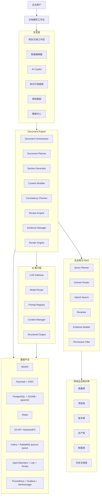

# 企业智能文档编写工作台——软件技术规格说明书

**文档编号**：EDW-TECH-SPEC-001  
**版本**：V1.1  
**状态**：研发技术基线（技术栈已确认）  
**日期**：2026-09-08

---

## 1. 文档目的

本规格定义“企业智能文档编写工作台”的软件设计与研发基线。系统接入公司已建设的企业知识库，覆盖质量、项目、技术、生产、制度、历史文档等知识域，并通过 LLM、RAG、模板引擎、文档工程和审校工作流，辅助员工编写高质量正式公司文档。

目标文档类型至少包括：

- 标书/技术标/商务响应材料；
- PRD、需求规格说明书；
- 总体技术方案、详细技术方案、部署方案；
- 测试方案、测试计划、功能性能试验大纲；
- 产品/系统技术要求；
- 质量大纲、质量保证计划；
- 项目计划、项目总结报告；
- 生产记录、检验记录、装配记录等生产表单。

本系统不是通用聊天机器人，而是企业级 **AI Document Engineering Workbench**。

---

## 2. 设计目标

### 2.1 业务目标

| ID | 目标 | 验收方式 |
|---|---|---|
| BG-01 | 高质量复用公司既有知识和历史优秀文档 | 关键内容可追溯至知识源 |
| BG-02 | 显著降低同类文档重复编写成本 | 典型文档编写工时下降 |
| BG-03 | 统一术语、格式、结构和质量标准 | Reviewer 自动检查通过 |
| BG-04 | 降低 AI 幻觉与无依据参数 | Claim 级证据覆盖率可量化 |
| BG-05 | 支持人机协同，而非 AI 无监督发布 | 正式发布必须经过人工确认/审批 |
| BG-06 | 形成“正式文档→可信知识”的闭环 | 只有 Approved/Published 文档可回灌 Golden Knowledge |

### 2.2 技术目标

1. 文档内部采用结构化 `Document AST`，而不是仅保存富文本或 Markdown。
2. 企业知识库通过 `Knowledge Gateway` 接入，不允许业务模块直连底层向量数据库。
3. 长文生成采用 `Document Plan -> Section Task -> Evidence -> Generate -> Review`。
4. 事实、参数、标准编号、版本、日期等关键 Claim 建立来源关系。
5. RAG 检索必须包含权限过滤、版本有效性和知识可信度。
6. AI 修改采用 Diff/Accept/Reject 模式，不直接覆盖正式内容。
7. 支持 DOCX/PDF/HTML/Markdown/XLSX 等输出，其中 DOCX 作为正式办公交付重点。
8. 平台必须提供完整 AI Audit Trail。

---

## 3. 范围

### 3.1 一期范围

第一优先级文档：

- 技术方案；
- PRD；
- 测试方案；
- 技术要求。

一期必须实现：

- 项目/文档工作区；
- 结构化智能编辑器；
- 模板中心；
- AI Copilot；
- 企业知识检索与引用；
- Evidence Pack；
- 分章节生成；
- 待确认项；
- Claim/Fact 检查；
- 全文一致性检查；
- 文档审校；
- AI Diff；
- 文档版本管理；
- DOCX/PDF 导出；
- 审计日志。

### 3.2 二期范围

新增：

- 质量大纲；
- 项目计划；
- 功能性能试验大纲；
- 项目总结报告；
- Document Quality Score；
- Requirement Coverage；
- Reviewer 规则中心；
- Golden Evaluation Set。

### 3.3 三期范围

新增专业工作台：

- 投标工作台；
- 生产表单工作台；
- AI Form Builder；
- MES/项目系统等业务系统集成。

### 3.4 非目标

一期明确不包含：

- 无审批的 AI 自动正式发文；
- 让 LLM 直接访问任意公司系统；
- AI 草稿自动进入可信知识库；
- 替代公司的正式 OA/电子签章/档案系统；
- 开放式、无边界的多 Agent 自主操作企业数据。

---

## 4. 用户与角色

| 角色 | 核心能力 |
|---|---|
| 普通编写人员 | 创建、编辑、AI 生成、引用、提交审校 |
| 项目成员 | 在授权项目空间内使用项目知识和模板 |
| 技术专家 | 技术 Reviewer、维护技术规则、处理关键问题 |
| 质量人员 | 质量审校、质量规则、正式文档质量门禁 |
| 模板管理员 | 维护公司级/部门级模板和版本 |
| 知识管理员 | 管理可用于生成的知识范围和可信度 |
| 审批人 | 审批正式发布 |
| 系统管理员 | 用户、角色、模型、Prompt、审计、平台配置 |

权限模型采用 `RBAC + ABAC`。知识库权限不得因 AI 检索而扩大。

---

## 5. 总体架构



---

## 6. 核心运行链路

### 6.1 新建文档

```text
用户选择项目/文档类型
        ↓
加载模板与写作规则
        ↓
解析项目上下文和附件
        ↓
推荐相似优秀文档
        ↓
Document Planner 生成文档计划
        ↓
生成/确认大纲
        ↓
拆分 Section Task
        ↓
逐章节检索 Evidence
        ↓
逐章节生成
        ↓
Claim 抽取与事实核验
        ↓
跨章节一致性检查
        ↓
Reviewer 审校
        ↓
人工修改/处理待确认项
        ↓
审批与正式输出
```

### 6.2 AI 修改

AI 修改必须遵循：

```text
Select Content
   ↓
Generate Patch
   ↓
Diff
   ↓
User Accept / Reject
   ↓
Write New Document Version
```

AI 不得静默覆盖正文。

### 6.3 正式文档回灌

```text
Published Document
   ↓
Knowledge Quality Gate
   ↓
Parse / Chunk / Metadata
   ↓
Golden Knowledge
```

`Draft`、`AI Draft`、未审批版本不得进入 Golden Knowledge。

---

## 7. 文档模型

### 7.1 Document AST

```text
Document
├── Metadata
├── Section[]
│   ├── Heading
│   ├── Paragraph
│   ├── Requirement
│   ├── Table
│   ├── Figure
│   ├── Diagram
│   ├── Citation
│   ├── Warning
│   └── Form
├── Claim[]
├── Evidence[]
├── ReviewIssue[]
└── Approval
```

### 7.2 文档状态

```text
DRAFT
→ CONTEXT_READY
→ OUTLINE_READY
→ GENERATING
→ REVIEWING
→ USER_REVIEW
→ APPROVAL_PENDING
→ PUBLISHED
→ ARCHIVED
```

异常状态：

- `GENERATION_FAILED`
- `REVIEW_FAILED`
- `EXPORT_FAILED`
- `BLOCKED_BY_MISSING_INFO`

---

## 8. 模板引擎

模板不仅是 Word 样式，而是以下内容的组合：

```text
Template =
Document Structure
+ Section Rules
+ Knowledge Retrieval Rules
+ Prompt Rules
+ Reviewer Rules
+ Rendering Style
+ Approval Policy
```

模板层级：

1. 公司级模板；
2. 部门级模板；
3. 产品线模板；
4. 项目模板；
5. 个人草稿模板。

模板采用严格版本控制。正式文档应记录生成时使用的 `template_id + version`。

模板章节示例：

```yaml
document_type: technical_solution
version: 3.2
sections:
  - id: project_overview
    title: 项目概述
    required: true
    knowledge_domains: [project, customer]

  - id: architecture
    title: 总体架构
    required: true
    knowledge_domains: [technical, product, project]
    reviewers: [technical, consistency]

  - id: acceptance
    title: 测试与验收
    required: true
    knowledge_domains: [test, quality, contract]
```

---

## 9. 企业知识接入

### 9.1 Knowledge Gateway

统一接口：

```http
POST /api/v1/knowledge/search
POST /api/v1/knowledge/evidence-packs
POST /api/v1/knowledge/similar-documents
GET  /api/v1/knowledge/documents/{id}
GET  /api/v1/knowledge/chunks/{id}
```

Gateway 负责：

- 用户权限下推；
- 知识域过滤；
- 项目/客户/产品上下文过滤；
- 版本有效性；
- 密级；
- 来源权威性；
- 查询审计。

### 9.2 知识优先级

| 级别 | 来源 |
|---|---|
| L0 | 法律法规、强制标准 |
| L1 | 公司正式制度/标准 |
| L2 | 当前项目正式资料 |
| L3 | 当前产品正式技术资料 |
| L4 | 已批准历史项目文档 |
| L5 | 部门知识 |
| L6 | 普通内部文档 |
| L7 | 允许使用的外部资料 |
| L8 | LLM 通用知识 |

发生冲突时优先高等级来源，同时生成 `KnowledgeConflict` 供人工处理。

---

## 10. Evidence 与 Claim

### 10.1 Evidence

每条 Evidence 至少保存：

- `source_document_id`
- `source_version`
- `source_section`
- `chunk_id`
- `evidence_text`
- `knowledge_level`
- `retrieval_score`
- `rerank_score`
- `permission_snapshot`
- `effective_at`

### 10.2 Claim

关键 Claim 类型：

- `performance`
- `quantity`
- `date`
- `version`
- `model`
- `requirement`
- `standard`
- `customer`
- `project`
- `compliance`

Claim 必须能够关联 0..N 条 Evidence。若关键 Claim 无 Evidence，则创建审校问题。

---

## 11. AI Copilot 功能

一期支持：

- 生成本章节；
- 续写；
- 重写；
- 扩写/缩写；
- 专业化/技术化；
- 改写为技术要求；
- 从需求生成测试项；
- 生成表格；
- 生成 Mermaid/PlantUML；
- 查询知识库；
- 查找相似历史方案；
- 检查事实；
- 检查遗漏；
- 检查冲突；
- 总结章节；
- 生成待确认项。

所有写操作均以 Patch/Diff 形式进入文档。

---

## 12. Reviewer 体系

一期至少实现：

| Reviewer | 主要检查 |
|---|---|
| Structure Reviewer | 必选章节、结构完整性 |
| Fact Reviewer | 事实与 Evidence 一致性 |
| Requirement Reviewer | 需求是否被响应/测试覆盖 |
| Technical Reviewer | 技术逻辑与关键约束 |
| Quality Reviewer | 公司质量制度和项目质量要求 |
| Consistency Reviewer | 术语、参数、章节之间一致性 |
| Style Reviewer | 公司写作规范 |
| Security Reviewer | 密级、敏感信息、外部模型风险 |

Reviewer 输出统一结构：

```json
{
  "issue_id": "ISSUE-001",
  "severity": "high",
  "type": "fact",
  "section_id": "sec-3.2",
  "claim_id": "claim-91",
  "message": "500 并发用户缺少有效依据",
  "suggestion": "补充性能测试报告或删除该参数",
  "status": "open"
}
```

---

## 13. 专业文档能力

### 13.1 标书

必须增加：

- 招标文件解析；
- 资格要求提取；
- 商务/技术要求拆解；
- 废标项识别；
- 评分项识别；
- Requirement Compliance Matrix；
- 双向响应追踪；
- 客户名称/项目名称残留检查；
- 参数冲突检查。

### 13.2 PRD

每个 Feature 应支持：

- FR-ID；
- 功能名称；
- 角色；
- 场景；
- 前置条件；
- 主流程；
- 异常流程；
- 业务规则；
- 输入/输出；
- 权限；
- NFR；
- 验收标准。

### 13.3 测试方案/试验大纲

建立：

```text
Requirement ↔ Test Item ↔ Test Case ↔ Acceptance Criteria
```

必须可输出需求覆盖率。

### 13.4 技术要求

Reviewer 应识别：

- 良好；
- 快速；
- 尽量；
- 适当；
- 高性能；
- 高可靠；
- 等模糊表述；

并建议转成“条件 + 指标 + 阈值 + 验证方式”。

### 13.5 生产记录表单

采用独立 `Form Schema`，支持：

- Text/Number/Date/Select；
- Checkbox；
- Signature；
- Image；
- Barcode/QR；
- Formula；
- Repeating Table。

同一 Schema 输出 Web、DOCX、PDF、XLSX、打印版。

---

## 14. 技术栈基线（已确认）

本节取代 V1.0 中“多后端候选/泛化基础设施”的建议性选型。除特别标注为“候选”的模型权重与部署规模外，下表均作为 V1.1 的**优先研发基线**。若后续替换组件，必须通过 ADR 记录原因、兼容边界、迁移方案与回归验证，不能由单一模块自行更换。

| 层级 | 选定基线 | 状态及应用边界 |
| --- | --- | --- |
| 前端框架 | ReactJS + TypeScript + Vite | ReactJS 已确认，其余已确认；构建 SPA |
| UI 与前端状态 | Ant Design + React Router + TanStack Query + Zustand | 已确认；分别管理组件、路由、服务端数据和少量界面状态 |
| 编辑器 | Tiptap 开源核心（基于 ProseMirror）+ 自建 Document AST 适配 | 已确认；不默认购买云服务或商业插件 |
| API 与校验 | FastAPI + Uvicorn + Pydantic 2 | FastAPI 已确认；Python 3.12 作为业务服务候选基线 |
| ORM、驱动与迁移 | SQLAlchemy 2 + psycopg 3 + Alembic | 已确认；API 与 Worker 独立连接池 |
| 业务数据 | PostgreSQL + JSONB | PostgreSQL 已确认；结构化实体与 AST 分层存储 |
| 缓存及限流 | Redis | 已确认；不作为文档、任务或审批的唯一持久化依据 |
| 异步执行 | Celery + RabbitMQ；生产任务队列采用 quorum queue | 已确认；生成、解析、渲染、集成任务分队列 |
| 调度与编排 | PostgreSQL 持久化状态机 + outbox + Celery Beat 单活调度 | 已确认；受控 DAG、人工暂停点和补偿扫描 |
| API 契约与推送 | REST `/api/v1` + OpenAPI + SSE | 已确认；操作请求走 HTTP，进度走可恢复事件流 |
| 入口代理 | NGINX | 已确认；TLS、静态资源、反向代理和流式响应配置 |
| 身份与授权 | Keycloak + OIDC；业务侧 RBAC + ABAC | 已确认；企业已有 IdP 通过标准协议适配 |
| 对象存储 | S3 API；自建缺省实现选 SeaweedFS | 已确认；企业已有 S3 服务通过适配验收后可替换 |
| 企业知识接入 | 自建 Python Knowledge Gateway + 知识库适配器 | 已确认；保留现有知识库为原始知识权威源 |
| 工作台附件检索 | pgvector + PostgreSQL 全文检索 + jieba 企业词典预分词 | 已确认；仅索引获授权的工作台附件和资料 |
| 向量与重排 | BGE-M3 + bge-reranker-v2-m3，采用 FlagEmbedding 适配 | 已确认；只用于自建检索链，现有库不强制重建向量 |
| 模型接入 | Python LLM Gateway（httpx + Pydantic） | 已确认；路由、输出约束、配额及审计属于业务控制层 |
| 自托管推理 | vLLM；正文及规划基准候选 Qwen3-32B | 已确认；模型权重、精度和部署规模必须经过 GPU 与效果评估 |
| 文档解析与 OCR | pypdf + python-docx + openpyxl + PaddleOCR | 已确认；解析和 OCR 采用独立镜像，按文件类型分派 |
| DOCX/PDF/XLSX | python-docx + docxtpl；LibreOffice；openpyxl | 已确认；AST 渲染、模板填充和格式转换分别负责 |
| 专项图形 | Mermaid CLI 隔离渲染；图片进入 AST 资源节点 | 已确认；模型生成的图形源码须校验，禁止任意执行 |
| 生产表单 | JSON Schema + React 表单组件 + Python JSON Schema 校验 | 已确认；实例版本化，表达式采用白名单解释器 |
| 企业集成 | Python 适配器 + httpx + outbox/inbox | 已确认；MES、归档和知识回流走明确契约 |
| 容器与部署 | Docker；开发联调 Compose；生产 Kubernetes + Helm | 已确认；生产依赖具备维护能力的集群，不在开发前强制建设生产集群 |
| 数据库生产运行 | CloudNativePG + Barman Cloud 备份插件 | 已确认；已有企业 PostgreSQL HA 服务可替代；备份放独立故障域 |
| 可观测性 | OpenTelemetry Collector + Prometheus + Grafana + Loki + Tempo + Alertmanager | 已确认；指标、追踪和日志分开处理 |
| 测试与工程 | pytest + Vitest/React Testing Library + Playwright + k6；Ruff、mypy、ESLint、TypeScript 检查 | 已确认；Python 用 uv 锁依赖，前端用 pnpm 锁依赖 |

### 14.1 关键实现约束

1. **业务服务以 Python 为主线**：API、Knowledge Gateway、LLM Gateway、业务集成适配器与 Celery Worker 均优先使用 Python 3.12；不再保留 Rust/Java/Go 作为一期核心业务服务候选。
2. **PostgreSQL 是业务事实源**：文档生命周期、任务状态、审批、Outbox、Audit 索引等必须落 PostgreSQL；Redis 与 Celery Broker 不承担唯一持久化责任。
3. **现有知识库保持权威源地位**：Knowledge Gateway 通过适配器调用现有知识库；BGE-M3/pgvector 链只覆盖工作台附件、自建资料或未来明确迁移的知识，不要求现有知识库重建向量。
4. **异步任务按业务类型分队列**：至少划分 `generation`、`retrieval`、`review`、`parse_ocr`、`render`、`integration`；生产 RabbitMQ 使用 quorum queue，消费端必须幂等。
5. **编排状态持久化**：受控 DAG/状态机保存于 PostgreSQL；Celery 只执行工作单元。使用 Transactional Outbox 保证“业务状态提交”和“任务/事件投递”之间的最终一致性，Celery Beat 仅负责单活周期扫描与补偿调度。
6. **SSE 为进度推送基线**：客户端通过可恢复事件流读取任务进度，事件包含单调序号/游标；WebSocket 不作为一期必选依赖。
7. **Document AST 与 Tiptap 解耦**：Tiptap/ProseMirror JSON 是编辑器表示，不直接等同于领域 AST；通过 AST Adapter 双向转换，服务端 AST Schema 是长期兼容契约。
8. **渲染与解析隔离**：PaddleOCR、LibreOffice、Mermaid CLI 等高资源或含外部执行面的组件进入独立 Worker/镜像，实施资源限额、超时、输入校验和沙箱约束。
9. **自托管模型需评测后定版**：Qwen3-32B 仅为正文/规划基准候选；GPU 数量、量化精度、上下文长度、吞吐和任务路由必须经 Golden Eval 与容量压测后冻结。
10. **生产基础设施允许等价替换**：已有企业 S3、PostgreSQL HA、IdP 可替换默认实现，但必须保持 S3/OIDC/PostgreSQL 等标准契约及本规格的 RPO/RTO、权限与审计要求。

## 15. 输出与渲染

文档源数据统一保存为 AST，导出链路：

```text
Document AST
├─ DOCX Renderer
├─ PDF Renderer
├─ HTML Renderer
├─ Markdown Renderer
└─ XLSX/Form Renderer
```

DOCX 必须支持：

- 公司封面；
- 文档编号；
- 密级；
- 页眉页脚；
- 自动目录；
- 标题编号；
- 图表编号；
- 公司字体；
- 审批页；
- 版本表；
- 引用/附录。

---

## 16. 关键质量门禁

正式发布前至少满足：

1. 必选章节完整；
2. 严重 Review Issue = 0；
3. 所有待确认项关闭或有批准的例外；
4. 关键 Claim Evidence 覆盖达到设定阈值；
5. 不存在已知知识冲突；
6. 不存在无权限引用；
7. 无敏感信息违规；
8. 模板版本有效；
9. 文档已人工确认；
10. 审批流程完成。

---

## 17. 非功能基线

| 类别 | 一期目标 |
|---|---|
| 普通知识检索 | P95 < 3 s |
| UI 关键操作 | P95 < 1 s |
| AI Copilot 首 Token | P95 < 5 s（外部模型网络正常条件） |
| 单章节生成 | 典型章节 P95 < 60 s |
| 自动保存 | P95 < 1 s |
| 平台可用性 | ≥ 99.9% |
| RPO | ≤ 15 min |
| RTO | ≤ 1 h |
| 审计覆盖 | AI/知识/文档/审批关键操作 100% |

具体模型响应时间单独统计，不与平台自身延迟混淆。

---

## 18. 研发拆分建议

一期可拆为 8 个 Epic：

1. Workspace & Document Core；
2. Structured Editor & AST；
3. Template Engine；
4. Knowledge Gateway & Evidence；
5. LLM Gateway & Generation Pipeline；
6. Reviewer & Quality Gate；
7. Render & Export；
8. Security, Audit & Operations。

每个 Epic 必须提供：

- API 契约；
- 数据迁移；
- 单元测试；
- 集成测试；
- 可观测性；
- 权限测试；
- 回滚方案。

---

## 19. 验收定义

一期不以“能生成文档”为验收终点，而以：

> **能够从公司可信知识和模板出发，稳定生成结构正确、关键事实可追溯、可人工审校和可正式导出的文档。**

作为完成标准。
