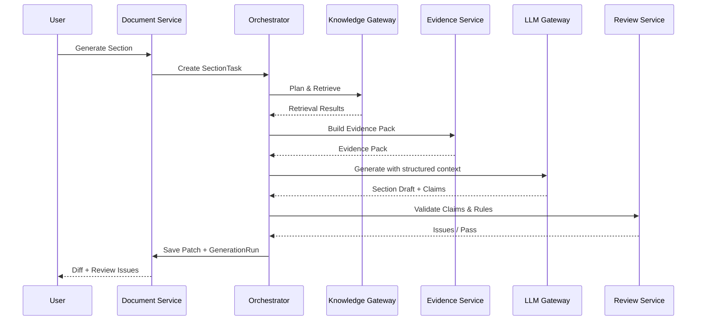

# 系统架构与模块设计

**文档编号**：EDW-TECH-SPEC-002  
**版本**：V1.1

---

## 1. 设计原则

1. **Document Engine 是核心**：LLM 和 RAG 都是能力提供者，不能反向控制文档生命周期。
2. **权限优先于召回率**：任何检索结果都必须先满足当前用户的知识访问权限。
3. **Evidence 先于正文**：正式文档关键章节优先建立 Evidence Pack 后再生成。
4. **结构化先于自然语言**：规划、需求、Claim、Issue、引用均优先结构化。
5. **异步任务可恢复**：长文生成、批量审校、导出均采用持久化任务。
6. **AI 不直接提交最终状态**：人工或业务工作流决定 `PUBLISHED`。

---

## 2. 逻辑模块

### 2.1 Workspace Service

职责：

- 项目空间；
- 成员与角色；
- 项目上下文；
- 项目文档列表；
- 最近文档/收藏/待办；
- 项目级模板和知识范围。

边界：

- 不保存正文 AST；
- 不直接调用 LLM；
- 不操作知识库向量索引。

### 2.2 Document Service

职责：

- Document 元数据；
- DocumentVersion；
- Section/Block；
- AST 读写；
- 版本创建；
- Diff/Patch；
- 锁与协同编辑；
- 状态转换。

关键约束：

- 每次 AI 修改必须关联 `generation_run_id`；
- 已发布版本不可原地修改；
- 新修改形成新版本或草稿分支。

### 2.3 Template Service

职责：

- 模板定义；
- 模板版本；
- 章节规则；
- Prompt 引用；
- Reviewer 引用；
- 渲染主题；
- 模板发布/停用。

模板版本一旦被正式文档引用，不允许物理删除。

### 2.4 Document Orchestrator

职责：

- 将“写一篇文档”拆成受控状态机；
- 生成 Document Plan；
- 创建 Section Task；
- 调用 RAG、LLM、Reviewer；
- 失败重试与恢复；
- 控制并发和预算；
- 基于 PostgreSQL 持久化状态机保存 DAG/人工暂停点；
- 通过 Transactional Outbox 投递 Celery 任务和领域事件；
- 由 Celery Beat 单活执行超时扫描、补偿扫描和周期任务。

约束：Celery/RabbitMQ/Redis 均不得成为文档任务状态的唯一事实源。

推荐状态：

```text
CREATED
→ PREPARING_CONTEXT
→ CONTEXT_READY
→ PLANNING
→ OUTLINE_READY
→ GENERATING
→ REVIEWING
→ USER_REVIEW
→ COMPLETED
```

Section Task：

```text
PENDING
→ RETRIEVING
→ EVIDENCE_READY
→ GENERATING
→ VALIDATING
→ DONE
```

异常：

```text
RETRY_WAIT
FAILED
BLOCKED
CANCELLED
```

### 2.5 Generation Service

职责：

- 章节写作；
- 内容改写；
- 大纲生成；
- 表格生成；
- 技术要求转换；
- 测试项生成；
- 总结；
- Patch 生成。

Generation Service 不直接查询向量库，只接受 Evidence Pack。

### 2.6 Review Service

职责：

- Reviewer 执行；
- Issue 去重；
- Severity；
- Issue 生命周期；
- 全文 Fact Table；
- Cross-Section 检查；
- 发布门禁。

### 2.7 Evidence Service

职责：

- Evidence Pack；
- Evidence 与 Claim 绑定；
- 引用格式；
- 来源追溯；
- 来源过期/失效；
- 权限快照；
- 冲突证据。

### 2.8 Render Service

职责：

- AST -> DOCX/PDF/HTML/MD；
- 公司主题；
- 页眉页脚；
- 图表编号；
- 目录；
- 审批页；
- 字体和版式；
- 导出任务管理。

### 2.9 Form Service

职责：

- Form Schema；
- 字段规则；
- 表格循环；
- 条码/二维码；
- 打印模板；
- Web/XLSX/PDF/DOCX 输出。

---

## 3. AI 能力层

### 3.1 LLM Gateway

统一所有 LLM 请求。V1.1 基线采用 **Python + httpx + Pydantic 2** 实现 Gateway 与 Provider Adapter；自托管模型通过 OpenAI-compatible 或受控内部适配接口接入，首选推理运行时为 vLLM。

最小职责：

- Provider Adapter；
- 模型能力标签；
- 任务路由；
- 超时；
- 重试；
- 限流；
- Token 预算；
- 敏感数据路由；
- Trace；
- 费用统计；
- 请求内容哈希；
- 输出安全检查。

### 3.2 Model Router

输入：

```json
{
  "task_type": "section_write",
  "security_level": "L2",
  "required_capabilities": ["long_context", "structured_output"],
  "max_cost": 0.5,
  "latency_class": "normal"
}
```

输出：

```json
{
  "model_profile": "internal-strong-writing-v2",
  "fallbacks": ["internal-general-v3"]
}
```

### 3.3 Prompt Registry

Prompt 不进入业务代码常量。

Prompt 组成：

```text
Global Policy
+ Document Type Policy
+ Section Instruction
+ Corporate Writing Guide
+ Reviewer Instruction
+ Runtime Context
```

Prompt 版本必须记录到 GenerationRun。

### 3.4 Context Manager

负责：

- 全文摘要；
- 章节前后摘要；
- 项目事实表；
- Glossary；
- 当前用户指令；
- Evidence 摘要；
- Token Budget。

禁止将全文所有原始知识直接塞入单次 Prompt。

---

## 4. RAG 层

### 4.1 Query Planner

输入：章节任务、文档类型、项目上下文。  
输出：3~10 个子查询。

例：

```json
{
  "section": "云桌面高可用设计",
  "queries": [
    "公司现行高可用设计规范",
    "当前项目可用性指标",
    "云桌面产品支持的HA能力",
    "历史类似项目的HA方案",
    "测试与验收中的故障切换要求"
  ]
}
```

### 4.2 Domain Router

知识域：

- quality；
- project；
- technical；
- product；
- production；
- policy；
- test；
- contract；
- history。

### 4.3 Hybrid Search

检索分为两条受控链路：

1. **现有企业知识库链路**：由 Python Knowledge Gateway 通过知识库适配器调用现有检索能力；现有知识库继续作为质量、项目、技术、生产、制度等知识的权威源，不要求为了本工作台重建向量。
2. **工作台附件链路**：仅对用户有权访问的工作台附件/临时资料建立本地索引，采用 `pgvector + PostgreSQL 全文检索 + jieba 企业词典预分词`；Embedding 使用 BGE-M3，Rerank 使用 bge-reranker-v2-m3，通过 FlagEmbedding 封装。

综合召回至少支持：

- Dense Vector；
- PostgreSQL FTS/Keyword；
- Metadata Filter；
- Similar Document；
- Exact Identifier Search；
- Existing Knowledge Adapter Results。

对标准编号、型号、项目编号、客户名称等优先走 Exact/Keyword，不依赖向量相似度。

### 4.4 Reranker

Rerank 输入必须保留：

- 来源权威性；
- 当前项目匹配度；
- 版本时效；
- 文档状态；
- 文档类型；
- 语义相关性。

最终得分不是单纯模型相关性分。

### 4.5 Permission Filter

权限过滤应尽可能在检索前下推，检索后再次校验。

```text
User Context
+ Role
+ Department
+ Project Membership
+ Client Scope
+ Product Scope
+ Classification Ceiling
```

---

## 5. 运行时架构

V1.1 采用“**React SPA + NGINX + FastAPI 模块化业务服务 + PostgreSQL 持久化编排 + Celery/RabbitMQ Worker + 独立 Knowledge/LLM Gateway**”作为一期运行时基线。

```text
Browser
  │ HTTPS / REST / SSE
  ▼
NGINX
  ├─ 静态资源：ReactJS + TypeScript + Vite
  ├─ TLS / Reverse Proxy / SSE Streaming
  └─ /api/v1
        │ OIDC Bearer Token
        ▼
FastAPI + Uvicorn + Pydantic 2  （Python 3.12）
  ├─ Workspace / Document / Template
  ├─ Review / Approval / Audit
  ├─ SSE Event API
  ├─ SQLAlchemy 2 + psycopg 3
  └─ Transactional Outbox
        │
        ├──────────────► PostgreSQL + JSONB
        │                 ├─ Domain Data / Document AST
        │                 ├─ Orchestrator State
        │                 ├─ Outbox / Inbox
        │                 └─ pgvector + FTS（仅工作台附件）
        │
        ├──────────────► Redis
        │                 └─ Cache / Rate Limit / Ephemeral Lock
        │
        └──────────────► RabbitMQ quorum queue
                          │
                          ▼
                     Celery Workers
                          ├─ generation
                          ├─ retrieval / review
                          ├─ parse_ocr
                          ├─ render
                          └─ integration

FastAPI / Celery
  ├────────► Python Knowledge Gateway ─► 现有企业知识库适配器
  │                                  └► 本地附件检索（BGE-M3 + pgvector/FTS + Reranker）
  ├────────► Python LLM Gateway ─────► vLLM / 外部受控 Provider
  ├────────► S3 API ─────────────────► SeaweedFS（缺省）/ 企业 S3
  └────────► Keycloak / OIDC

Render/Parse Isolated Workers
  ├─ pypdf / python-docx / openpyxl / PaddleOCR
  ├─ python-docx / docxtpl / openpyxl
  ├─ LibreOffice
  └─ Mermaid CLI（隔离执行）

Observability
  └─ OpenTelemetry Collector
      ├─ Prometheus + Grafana
      ├─ Loki
      ├─ Tempo
      └─ Alertmanager
```

### 5.1 前端运行边界

- React Router 管理 SPA 路由；
- TanStack Query 管理服务端缓存、请求重试与失效；
- Zustand 仅保存少量编辑器/面板等客户端状态，不复制服务端事实源；
- Ant Design 提供基础组件；
- Tiptap 开源核心负责编辑体验，通过自建 Adapter 与 Document AST 转换；
- 任务进度使用 SSE，可基于 `Last-Event-ID`/cursor 恢复；一期不要求 WebSocket。

### 5.2 API 与 Worker 连接池

API 与 Celery Worker 使用独立 SQLAlchemy/psycopg 连接池，分别限额；长任务不得持有跨 LLM/RAG 调用的数据库事务。Alembic 是唯一数据库 Schema 迁移入口。

### 5.3 Broker 与调度

- RabbitMQ 生产任务队列使用 quorum queue；
- Celery task 必须具备幂等键、可重试策略和明确超时；
- Celery Beat 单活，不承担业务状态；
- PostgreSQL 状态机 + Outbox 负责恢复和补偿扫描；
- 不以 Celery result backend 作为审批、生成、导出状态的最终依据。

### 5.4 对象存储

业务只依赖 S3 API。自建缺省实现为 SeaweedFS；若公司已有 S3 服务，通过兼容性、权限、版本、生命周期与性能验收后可替换。

## 6. 关键时序

### 6.1 章节生成



### 6.2 “检查事实”

1. 抽取关键 Claim；
2. 对 Claim 发起定向检索；
3. 关联 Evidence；
4. 计算支持/冲突/未知；
5. 形成 Issue；
6. 用户接受修改或补充资料。

---

## 7. 错误处理

### 7.1 LLM 失败

策略：

1. 瞬时错误：指数退避重试；
2. 供应商错误：Fallback；
3. Structured Output 解析失败：Repair 一次；
4. 多次失败：任务标记 `FAILED`，保留上下文；
5. 不自动切换到不满足密级的外部模型。

### 7.2 RAG 无有效证据

不得让 LLM“自由补全”关键参数。

输出：

```text
【待确认】
当前知识范围内未找到“系统最大并发用户数”的有效依据。
```

### 7.3 Evidence 过期

如果来源已经存在新版本：

- 标记 `STALE_EVIDENCE`；
- Reviewer 提示；
- 正式发布前需重新绑定有效来源或批准例外。

### 7.4 权限变化

发布前重新校验所有 Evidence 当前权限与知识状态。  
历史审计仍保存当时权限快照，但不得因此继续向用户暴露已撤销正文。

---

## 8. 降级策略

### 场景一：LLM 不可用

系统仍应支持：

- 手工编辑；
- 知识搜索；
- 引用；
- 模板；
- 版本；
- 审批；
- 导出。

### 场景二：知识库不可用

允许编辑，但：

- 新 Evidence 生成关闭；
- AI 正式文档生成进入受限模式；
- 明显提示“企业知识不可用”。

### 场景三：Reviewer 不可用

允许保存草稿，不允许通过依赖 Reviewer 的发布门禁。

---

## 9. 前端关键状态

必须实现：

- Loading；
- Streaming；
- Generation Queued；
- Evidence Building；
- Review Running；
- Diff Waiting；
- Missing Information；
- Permission Denied；
- Offline/Degraded；
- Exporting；
- Approval Pending。

禁止使用单一“AI 正在思考”覆盖所有运行状态。

---

## 10. 设计决策

### ADR-001：采用 Document AST

原因：

- 支持结构化编辑；
- 支持多格式导出；
- 支持精细 Diff；
- 支持 Claim/引用挂接；
- 支持表单；
- 便于自动审校。

### ADR-002：采用受控 Orchestrator，而非开放式 Agent

原因：

- 可审计；
- 可恢复；
- 可控制费用；
- 权限边界清晰；
- 适合正式企业文档。

### ADR-003：Knowledge Gateway 隔离知识库内部实现

原因：

- 未来可更换向量库；
- 统一权限；
- 统一 Metadata；
- 统一质量规则。

### ADR-004：正式知识只接受 Approved/Published 文档

原因：

- 防止 AI 错误自增强；
- 防止草稿污染；
- 保持可信知识闭环。

### ADR-005：一期业务服务统一 Python/FastAPI

原因：业务编排、文档解析、RAG/LLM 生态、Pydantic 结构化契约和 Celery Worker 可共享类型与工具链，降低多语言服务治理成本。一期不引入 Rust/Java/Go 核心业务服务。

### ADR-006：Celery + RabbitMQ 只执行任务，PostgreSQL 保存编排事实

原因：避免 Broker/Redis 丢失导致任务生命周期不可审计；采用 PostgreSQL 状态机 + Outbox + 幂等 Worker 构成可恢复的受控 DAG。

### ADR-007：现有知识库与工作台附件索引分离

原因：保护现有知识库的权威性与既有索引投资；本地 BGE-M3/pgvector/FTS 只服务工作台授权附件，不强制迁移或重建现有知识向量。

### ADR-008：SSE 作为一期异步进度推送协议

原因：生成、解析、渲染以服务端单向进度为主，SSE 更容易穿透 NGINX、支持断线恢复并降低双向长连接复杂度。
